# Professional Git & GitHub Team Workflow

From **creating a local branch** → **setting upstream** → **pushing** → **Pull Request** → **merge** → **cleanup**.

Every step has: 🔧 **Command** → 💬 **In plain words** → 👁️ **Picture & Link** → 🔍 **Diagram Breakdown**.

> 📁 **Note on Images:** All workflow diagrams are stored locally in the [`./images/`](./images/) folder. Each diagram is embedded below and also linked directly so you can click to view or zoom in full resolution.

---

## 📖 How to read the pictures (read this once!)

[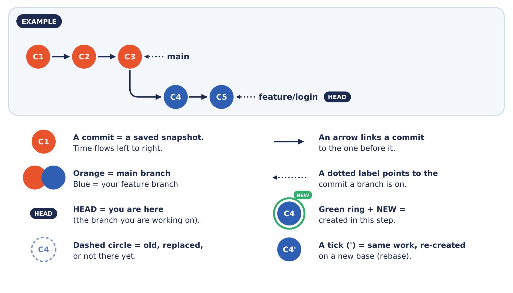](./images/00-legend.png)

*🔗 [Click to open legend diagram in full resolution](./images/00-legend.png)*

#### 🔍 Diagram Breakdown & Visual Symbols
- **Circles (`C1`, `C2`, `C3`, ...)**: Represent individual **Git commits** (saved snapshots). Time flows horizontally from left to right.
- **Orange Circles**: Represent commits on the shared team branch: `main`.
- **Blue Circles**: Represent commits on your personal isolated branch: `feature/login`.
- **Solid Connecting Arrows (`→`)**: Represent the commit history chain pointing from earlier work to new work.
- **Dotted Labels (`⇠ main`, `⇠ feature/login`)**: Represent **branch pointers**. In Git, a branch is not a folder or a copy—it is simply a lightweight, movable pointer pointing to a specific commit hash.
- **`HEAD` Pill**: Shows **where you currently are**. Your active working directory always reflects the commit that `HEAD` points to.
- **Green Ring + `NEW` Badge**: Visual indicator for commits, branches, or links that were newly created or updated during the current step.
- **Dashed Circles**: Show old commits that were replaced, rebased, or discarded from the active branch history.
- **Tick Mark (`'`) notation (e.g., `C4'`)**: Represents rebased commits. The changes in `C4'` are identical to `C4`, but it has a new commit hash and a new parent commit because it was replayed on top of newer code.

> 🧠 **Key idea:** A branch is **only a 41-byte text pointer** pointing to a commit hash. Creating, switching, or deleting a branch is instantaneous and costs zero disk space.

### The story we follow in this guide
You are collaborating on a team of three developers building a web application. Your assignment is to build the **user login page**. The project already has 3 initial commits (`C1`, `C2`, `C3`) on `main`.

---

## 🗺️ The Big Picture (11 steps)

[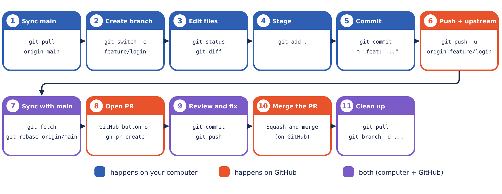](./images/01-big-picture.png)

*🔗 [Click to open the 11-step overview diagram in full resolution](./images/01-big-picture.png)*

#### 🔍 Diagram Breakdown & Color Guide
The complete development cycle is structured into 11 logical steps color-coded by where the action executes:
1. **Blue Steps (1, 2, 3, 4, 5)**: **Local computer operations.** Everything happens entirely offline on your local machine. No internet or network connection required.
2. **Orange Steps (6, 8, 10)**: **GitHub / Remote operations.** Interacting with GitHub's servers (publishing your branch, creating the Pull Request, executing the merge).
3. **Purple Steps (7, 9, 11)**: **Hybrid / Synchronization operations.** These steps connect your local machine with GitHub (fetching updates from teammates, pushing fixes in response to code reviews, synchronizing the merged `main` branch, and pruning deleted branches).

---

# STEP 0 — One-time setup (once per computer)

### 🔧 Command

```bash
# Clone the remote repository to your local computer
git clone https://github.com/<team>/<project>.git
cd <project>
```

### 💬 In plain words
`clone` downloads the full Git repository—including its entire commit history, all branches, and all files—from GitHub onto your local computer.

### 👁️ Picture & Link

[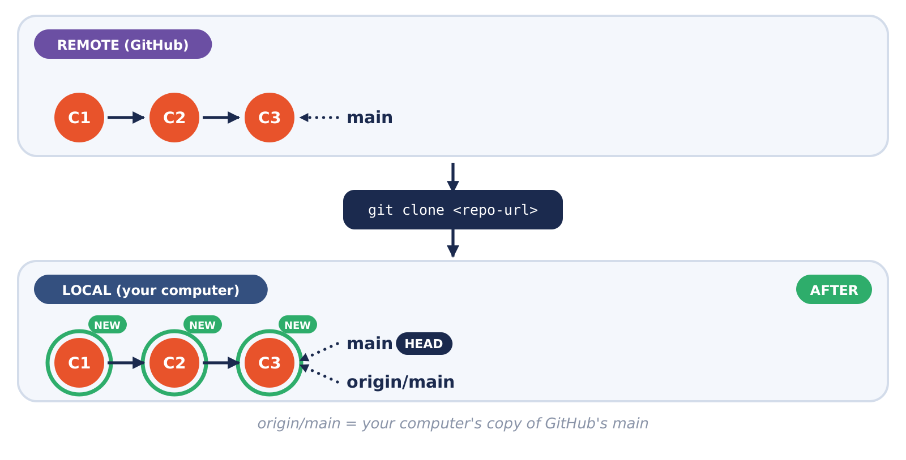](./images/02-step0-clone.png)

*🔗 [Click to open Step 0 diagram in full resolution](./images/02-step0-clone.png)*

#### 🔍 Diagram Breakdown & What Happens
- **REMOTE (GitHub)**: The server repository contains commits `C1 → C2 → C3` on the default branch `main`.
- **Command**: `git clone <repo-url>` creates a local folder and pulls down all repository data.
- **LOCAL (your computer) AFTER**:
  - Commits `C1`, `C2`, and `C3` are initialized locally (highlighted with green rings and `NEW`).
  - Git creates a local branch named `main` pointing to `C3`.
  - `HEAD` is placed on `main` (`main HEAD`), checking out the latest project files into your working folder.
  - A hidden remote-tracking pointer named `origin/main` is established pointing to `C3`. This acts as your local computer's cached bookmark of where GitHub's `main` branch is located.

---

# STEP 1 — Sync `main` (always start from the latest code)

### 🔧 Command

```bash
git switch main
git pull origin main
```

### 💬 In plain words
Before starting any new work, always pull the latest updates. Teammates may have merged new features while you were away. `pull` downloads those commits so you start on top of the freshest code.

### 👁️ Picture & Link

[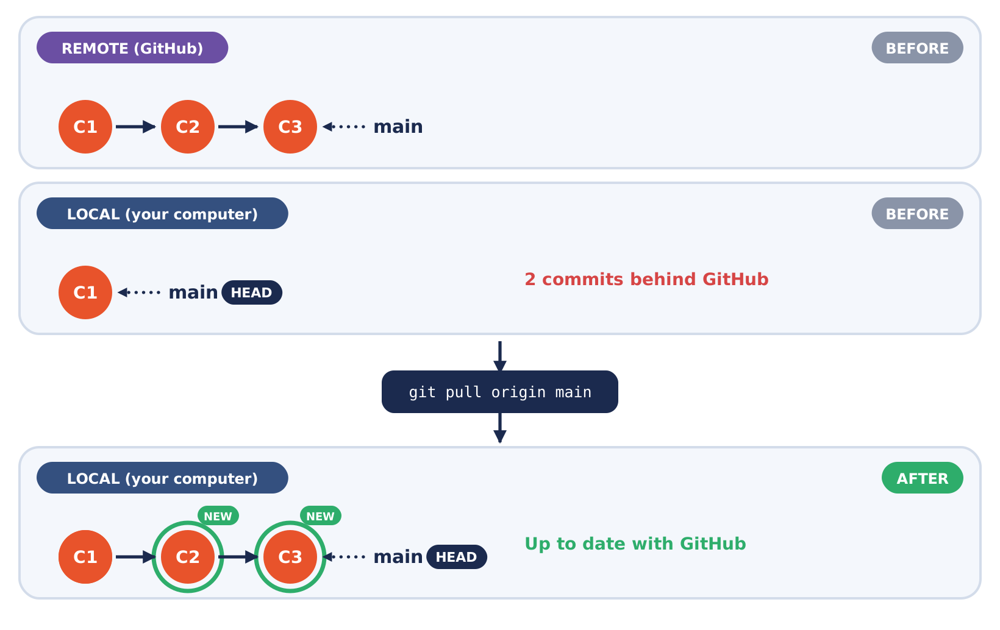](./images/03-step1-pull.png)

*🔗 [Click to open Step 1 diagram in full resolution](./images/03-step1-pull.png)*

#### 🔍 Diagram Breakdown & What Happens
- **REMOTE (GitHub) BEFORE**: Teammates pushed commits `C2` and `C3` to GitHub. The remote `main` is at `C3`.
- **LOCAL (your computer) BEFORE**: Your local machine was only at `C1` ("2 commits behind GitHub").
- **Command**: `git pull origin main` contacts GitHub, downloads the missing commits (`C2`, `C3`), and advances your local branch.
- **LOCAL (your computer) AFTER**: Local `main` moves forward to `C3` (`C2` and `C3` marked `NEW`). `HEAD` now points to `C3`. Your local environment is now fully synchronized ("Up to date with GitHub").

---

# STEP 2 — Create a local branch

### 🔧 Command

```bash
git switch -c feature/login
```

*(Older equivalent syntax: `git checkout -b feature/login`)*

Verify your current branch:

```bash
git branch
```

```text
* feature/login        ← the asterisk (*) and green highlight mean "you are here"
  main
```

### 💬 In plain words
The `-c` flag stands for **c**reate. You create a new branch pointer and switch to it in a single command. **Nothing is duplicated or copied on your hard drive.** Git simply creates a new label pointing to the exact same commit you are already on.

### 👁️ Picture & Link

[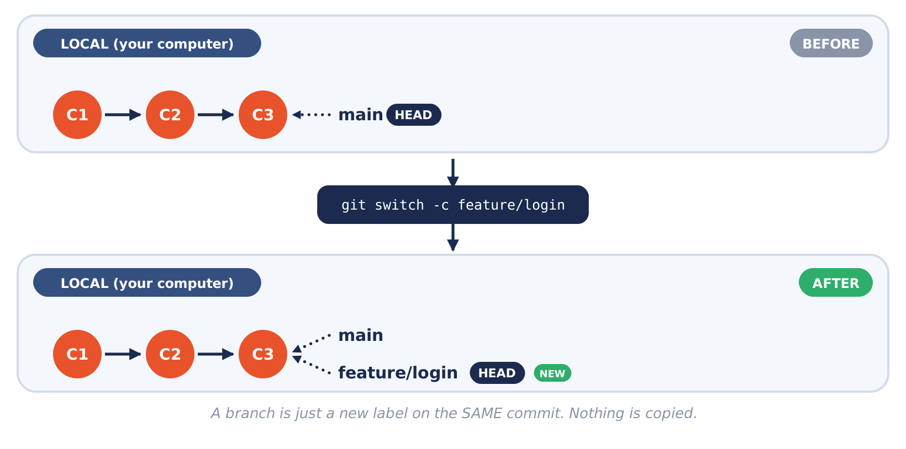](./images/04-step2-branch.png)

*🔗 [Click to open Step 2 diagram in full resolution](./images/04-step2-branch.png)*

#### 🔍 Diagram Breakdown & What Happens
- **LOCAL (BEFORE)**: `main` points to `C3`, and `HEAD` is attached to `main`.
- **Command**: `git switch -c feature/login`.
- **LOCAL (AFTER)**: A new branch pointer named `feature/login` (`NEW`) is created pointing at commit `C3`.
- `HEAD` instantly detaches from `main` and attaches to `feature/login`.
- `main` stays safely behind at `C3`. Any upcoming work will belong only to `feature/login`.

### 📝 Team Branch Naming Conventions

| Prefix | When to use | Example |
|---|---|---|
| `feature/` | New functionality or feature development | `feature/login`, `feature/cart-checkout` |
| `fix/` | Normal bug fixes | `fix/navbar-overflow`, `fix/login-button-align` |
| `hotfix/` | Urgent production fixes needing immediate release | `hotfix/payment-gateway-crash` |
| `docs/` | Documentation improvements only | `docs/api-endpoints`, `docs/readme-setup` |
| `refactor/` | Code refactoring without behavioral changes | `refactor/auth-service`, `refactor/db-queries` |
| `test/` | Adding or updating automated tests | `test/login-unit-tests` |

---

# STEP 3 — Work, then look at what changed

### 🔧 Command

```bash
git status        # Which files were created, modified, or deleted?
git diff          # What exact lines of code changed inside those files?
```

### 💬 In plain words
You edit code inside your favorite editor (VS Code, Cursor, etc.). Git monitors your workspace. Running `status` and `diff` lets you inspect your modifications before staging them.

### 👁️ Picture & Link

[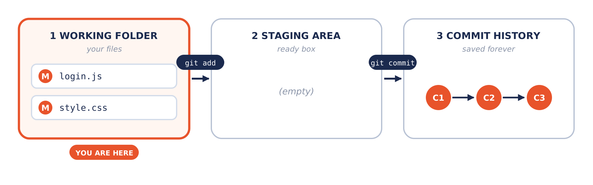](./images/05-step3-edit.png)

*🔗 [Click to open Step 3 diagram in full resolution](./images/05-step3-edit.png)*

#### 🔍 Diagram Breakdown & Git's Three Areas
Git tracks work across three distinct zones:
1. **Area 1 — WORKING FOLDER (Your files)**: Your live workspace on disk. Files `login.js` and `style.css` are modified (`M`). The orange border and "YOU ARE HERE" badge indicate uncommitted changes are present here.
2. **Area 2 — STAGING AREA ("Ready box" / Index)**: Currently empty. No changes are prepared for snapshotting yet.
3. **Area 3 — COMMIT HISTORY ("Saved forever" / Repository)**: Contains the immutable historical chain `C1 → C2 → C3`. Nothing new has been recorded yet.

---

# STEP 4 — Stage the changes

### 🔧 Command

```bash
# Best practice: stage specific files explicitly
git add login.js style.css

# Or stage all changed files in the directory (always check git status first!)
git add .
```

### 💬 In plain words
Staging means **carefully selecting what goes into your next commit**. Think of the staging area as putting selected items into a shipping box before taping it shut and printing the label.

### 👁️ Picture & Link

[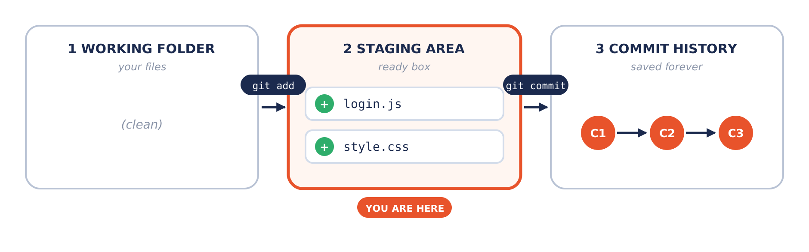](./images/06-step4-stage.png)

*🔗 [Click to open Step 4 diagram in full resolution](./images/06-step4-stage.png)*

#### 🔍 Diagram Breakdown & What Happens
- **Command**: `git add login.js style.css`.
- **Area 1 (WORKING FOLDER)**: Now clean for these files.
- **Area 2 (STAGING AREA)**: Now holds `+ login.js` and `+ style.css` with a green plus badge. The orange outline and "YOU ARE HERE" badge show that your changes have moved into the staging ready box, waiting to be sealed into history.
- **Area 3 (COMMIT HISTORY)**: Still at `C1 → C2 → C3`.

---

# STEP 5 — Commit (save a snapshot)

### 🔧 Command

```bash
git commit -m "feat: add login form UI"
```

Continue building in small, focused iterations:

```bash
# Second small commit
git add .
git commit -m "feat: validate email and password format"

# Third small commit
git add .
git commit -m "fix: show error on wrong credentials"
```

### 💬 In plain words
`commit` permanently seals the staged changes into the repository history. It produces a **new commit on your branch only**. `main` is completely untouched.

### 👁️ Picture & Link

[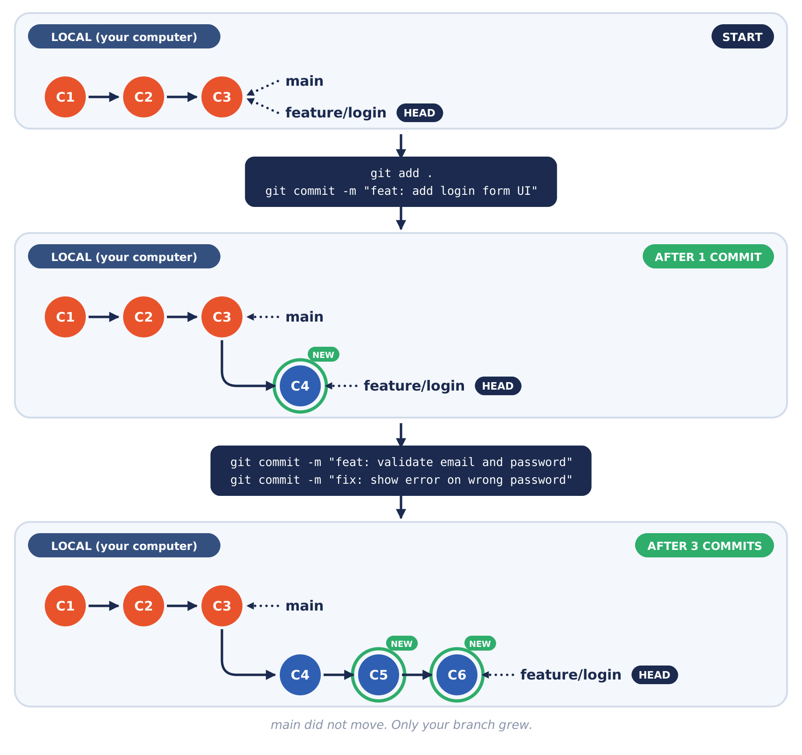](./images/07-step5-commit.png)

*🔗 [Click to open Step 5 diagram in full resolution](./images/07-step5-commit.png)*

#### 🔍 Diagram Breakdown & Commit Progression
- **START**: `main` and `feature/login` (with `HEAD`) both pointed to `C3`.
- **AFTER 1 COMMIT (`git commit -m "feat: add login form UI"`)**:
  - A new commit `C4` (blue circle, green border, `NEW`) is created.
  - `feature/login` and `HEAD` automatically advance to `C4`.
  - `main` remains untouched at `C3`.
- **AFTER 3 COMMITS**:
  - Commits `C5` and `C6` are sequentially added.
  - The branch now reads: `C3 → C4 → C5 → C6`.
  - `feature/login` and `HEAD` point to `C6`.
  - `main` still remains at `C3`. Only your feature branch grew!

### Inspect your commit graph anytime

```bash
git log --oneline --graph --all
```

```text
* c3d4e5f (HEAD -> feature/login) fix: show error on wrong credentials
* b2c3d4e feat: validate email and password format
* a1b2c3d feat: add login form UI
* 9z8y7x6 (main) previous teammate work
```

### ✍️ Professional Commit Message Guidelines (Conventional Commits)

```text
<type>: <short imperative summary>
```

| Type | When to use |
|---|---|
| `feat:` | A brand-new feature or capability |
| `fix:` | A bug fix |
| `docs:` | Documentation changes only |
| `refactor:` | Code reorganization without changing external behavior |
| `test:` | Adding or correcting automated tests |
| `chore:` | Updating dependencies, configs, or build scripts |

| ❌ Poor Commit Message | ✅ Professional Commit Message |
|---|---|
| `update stuff` | `feat: add login form UI` |
| `fixed bug` | `fix: display banner when login credentials fail` |
| `final version 2` | `refactor: extract email validation into helper function` |

---

# STEP 6 — Push the branch and set the upstream

### 🔧 Command

```bash
git push -u origin feature/login
```

*(Long-form equivalent: `git push --set-upstream origin feature/login`)*

### 💬 In plain words
- `push` = uploads your local branch and commits to GitHub.
- `origin` = standard nickname for your remote repository on GitHub.
- `-u` (**upstream**) = creates a permanent tracking bond between your local branch `feature/login` and the remote branch `origin/feature/login`. After doing this once, you can simply type `git push` or `git pull` without specifying the remote or branch name.

### 👁️ Picture & Link

[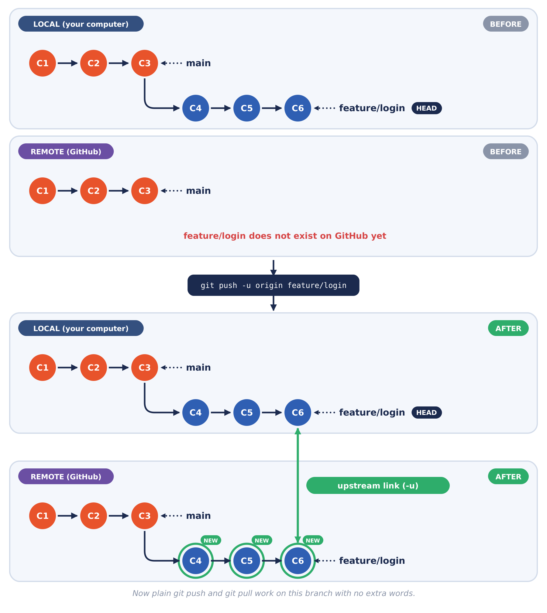](./images/08-step6-push-upstream.png)

*🔗 [Click to open Step 6 diagram in full resolution](./images/08-step6-push-upstream.png)*

#### 🔍 Diagram Breakdown & What Happens
- **BEFORE (Top half)**:
  - LOCAL: Has commits `C4 → C5 → C6` on `feature/login` with `HEAD`.
  - REMOTE (GitHub): Only knows about `C1 → C2 → C3` on `main`. The `feature/login` branch **does not exist on GitHub yet**.
- **Command**: `git push -u origin feature/login`.
- **AFTER (Bottom half)**:
  - REMOTE (GitHub): Receives commits `C4`, `C5`, and `C6` (marked with green borders and `NEW`). Remote branch `feature/login` is created.
  - The green vertical link (`upstream link (-u)`) connects local `feature/login` with GitHub's `feature/login`.
  - Now your branch is backed up in the cloud, teammates can see your work, and future pushes require only `git push`.

### Verify the upstream link

```bash
git branch -vv
```

```text
* feature/login  c3d4e5f [origin/feature/login] fix: show error on wrong credentials
  main           9z8y7x6 [origin/main] previous teammate work
```

The bracketed `[origin/feature/login]` confirms that the upstream relationship is properly established.

---

# STEP 7 — Update your branch if `main` moved on (Merge way)

While you were working on your branch, your teammates merged their own Pull Requests into `main`. **Before opening your PR, always bring those new changes into your branch.**

### 🔧 Command (Primary Method: Merge)

```bash
git fetch origin               # Download all remote updates without touching your files
git merge origin/main          # Join the latest main into your feature branch
git push                       # Push to GitHub (standard push — no force-push needed!)
```

### 💬 In plain words
`git merge origin/main` brings all new commits merged into `main` by your teammates directly into your feature branch via a dedicated **merge commit (`M`)**. 
- It preserves your exact commit history and commit IDs.
- It requires **no force-pushing**, making it safe, predictable, and beginner-friendly.
- Anyone collaborating with you on your branch can continue pulling without issues.

### 👁️ Picture & Link: Merge (Standard)

[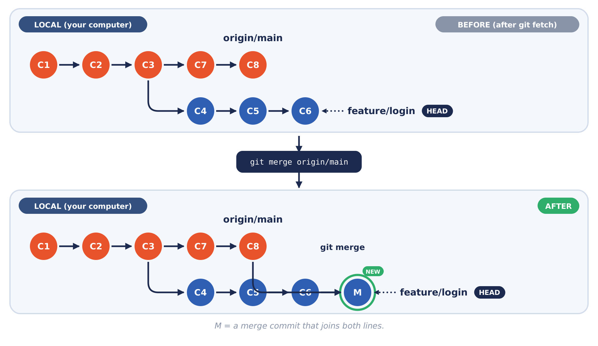](./images/10-step7-merge-alt.png)

*🔗 [Click to open Step 7 Merge diagram in full resolution](./images/10-step7-merge-alt.png)*

#### 🔍 Diagram Breakdown: Merge
- **BEFORE (after `git fetch`)**:
  - Teammates merged commits `C7` and `C8` into `main` (`origin/main` is at `C8`).
  - Your local branch `feature/login` contains commits `C4 → C5 → C6`.
- **Command**: `git merge origin/main`.
- **LOCAL AFTER**:
  - Rather than rewriting or replaying history, Git creates a dedicated **merge commit `M`** (green ring, `NEW`).
  - Commit `M` has two parent commits: `C6` (your latest feature commit) and `C8` (the latest commit from `origin/main`).
  - Your original commit hashes (`C4`, `C5`, `C6`) stay completely intact and untouched.
- **Command**: `git push` sends commit `M` to GitHub normally—no `--force` or `--force-with-lease` required!

---

### 🔀 Alternative Method: Rebase instead of merge (For linear history)

If your team's policy explicitly requires a single straight line of commits without merge commits:

```bash
git fetch origin               # Download latest commits
git rebase origin/main         # Replay your commits on top of the newest main
git push --force-with-lease    # Update GitHub (force-push required because history was rewritten)
```

[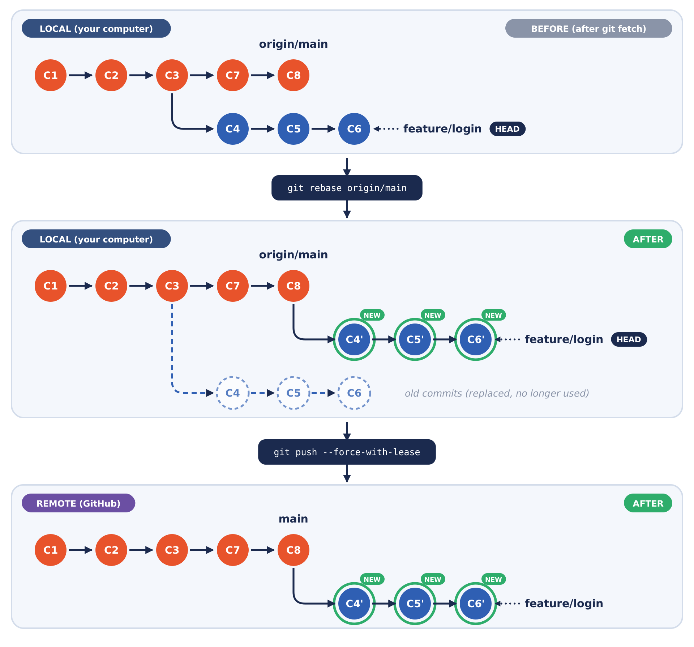](./images/09-step7-rebase.png)

*🔗 [Click to open Step 7 Rebase diagram in full resolution](./images/09-step7-rebase.png)*

#### 🔍 Diagram Breakdown: Rebase
- Git lifts commits `C4, C5, C6` (shown as dashed circles: old commits replaced).
- Your branch starting point moves to `C8`, and your changes are replayed on top of `C8` as new commits `C4', C5', C6'`.
- Requires `git push --force-with-lease` to update GitHub.

> ⚠️ **Safety Rules for Rebasing:**
> 1. Use `--force-with-lease`, **never** bare `--force`.
> 2. **Rebase only your own feature branch.** Never rebase `main` or any branch shared by other developers.

---

### Comparison: Merge vs Rebase

| Feature | `git merge origin/main` (Primary) | `git rebase origin/main` (Alternative) |
|---|---|---|
| **Git History** | Diamond-shaped branches joined by a merge commit (`M`) | Perfectly linear, clean single line (`C4' → C5' → C6'`) |
| **Commit Hashes** | Preserved exactly as originally created | Recreated with new hashes (`C4 → C4'`) |
| **Push Command** | Standard `git push` (safe & simple) | Requires `git push --force-with-lease` |
| **Safety** | Safest for teams & beginners | Requires caution to not rewrite shared commits |

---

### ⚔️ Resolving Merge Conflicts

If you and a teammate edited the same line of the same file, Git pauses during the merge and marks the conflict:

```text
<<<<<<< HEAD (Your current branch feature/login)
const API_URL = "https://api.company.com/v1-auth";
=======
const API_URL = "https://api.company.com/v2";
>>>>>>> origin/main (Incoming changes from main)
```

**How to resolve:**
1. Open the file in your code editor.
2. Select which code to keep (or combine both).
3. **Delete the conflict markers** (`<<<<<<<`, `=======`, `>>>>>>>`).
4. Save the file, stage it, and commit the merge:

```bash
git add <resolved-file>

# Finalize the merge commit:
git commit -m "chore: resolve merge conflicts with main"
git push
```

Need to cancel and reset back to where you started?

```bash
git merge --abort       # cancels merge completely and safely
# or if rebasing:
git rebase --abort      # cancels rebase completely
```

---

# STEP 8 — Open the Pull Request (PR)

### 🔧 Method 1: Via the GitHub Web UI
1. Navigate to the repository page on GitHub.
2. A yellow notification banner will say: `feature/login had recent pushes...` → Click **Compare & pull request**.
3. Verify the branch direction: **base: `main`** ⟵ **compare: `feature/login`**.
4. Enter an informative title and summary.
5. In the right sidebar, assign **Reviewers** (teammates).
6. Click **Create pull request**.

### 🔧 Method 2: Via Terminal using GitHub CLI (`gh`)

```bash
gh pr create --base main --head feature/login \
  --title "feat: add user login page" \
  --body "Implements login form UI, input validation, and error alert handling."
```

### 💬 In plain words
A Pull Request is a formal request saying: *"I have completed my feature on this branch. Please review my code and merge it into `main`."* No code is merged yet.

### 👁️ Picture & Link

[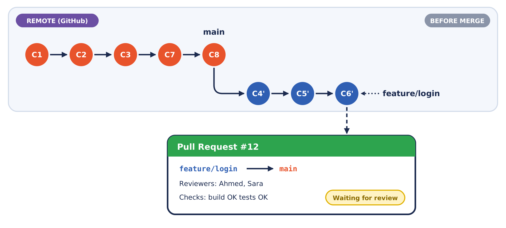](./images/11-step8-pull-request.png)

*🔗 [Click to open Step 8 diagram in full resolution](./images/11-step8-pull-request.png)*

#### 🔍 Diagram Breakdown & PR State
- **REMOTE (GitHub)**: Branch `feature/login` (`C4' → C5' → C6'`) is based directly on `C8` of `main`.
- **Pull Request #12**:
  - Compares `feature/login` against target `main`.
  - Reviewers assigned: Ahmed, Sara.
  - Automated CI/CD checks running: Build OK, Tests OK.
  - Status indicator: **Waiting for review**.

### 📋 Recommended PR Description Template

```markdown
## What
Added responsive login form with email & password validation and error alerts.

## Why
Enables registered users to log in securely to their dashboards. Resolves issue #42.

## How to Test
1. Run `npm start` and visit `http://localhost:3000/login`.
2. Enter an invalid email format → Verify validation warning displays.
3. Enter incorrect password → Verify alert banner appears.
4. Enter correct credentials → Verify successful redirect to `/dashboard`.

## Screenshots
[Attach UI screenshot or GIF here]
```

---

# STEP 9 — Code review and fix feedback

### 🔧 Command

```bash
# Ensure you are on your feature branch
git switch feature/login

# Make the edits requested by your reviewer...
git add .
git commit -m "fix: rename auth payload variable as requested in review"

# Push the fix to GitHub (no branch name needed thanks to upstream link!)
git push
```

### 💬 In plain words
You do not open a new PR. You make the requested edits locally, commit them, and push them to the **same branch**. GitHub detects the new commit and automatically updates the open PR.

### 👁️ Picture & Link: Review & Fix

[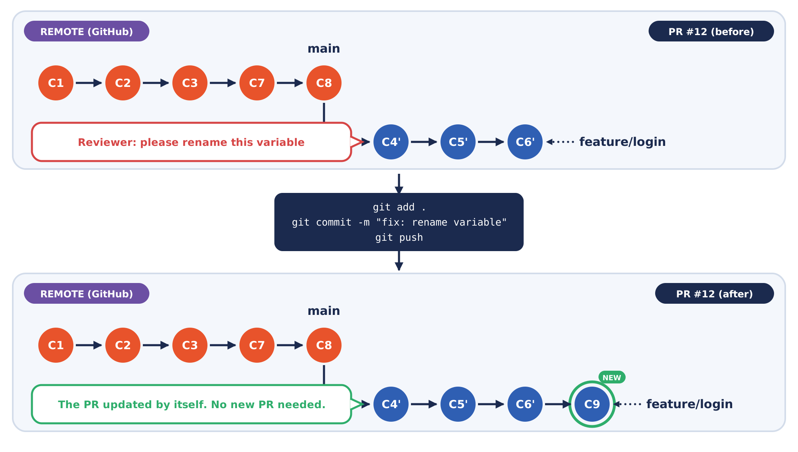](./images/12-step9-review-fix.png)

*🔗 [Click to open Step 9 Review & Fix diagram in full resolution](./images/12-step9-review-fix.png)*

#### 🔍 Diagram Breakdown: PR Auto-Update
- **PR #12 (BEFORE)**: Teammate leaves a line comment on commit `C4'`: *"Reviewer: please rename this variable"*.
- **Command**: You address the comment, create commit `git commit -m "fix: rename variable"`, and run `git push`.
- **PR #12 (AFTER)**: Commit `C9` (green border, `NEW`) is appended directly to `feature/login`. The green banner confirms: *"The PR updated by itself. No new PR needed."*

### 🔄 The Code Review Loop

[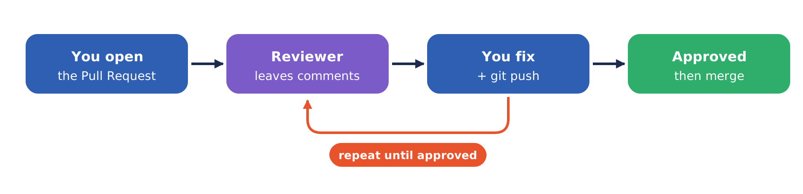](./images/13-step9-review-loop.png)

*🔗 [Click to open the Review Loop diagram in full resolution](./images/13-step9-review-loop.png)*

#### 🔍 Diagram Breakdown: The Review Cycle
1. **You open** the Pull Request.
2. **Reviewer** inspects changes and leaves comments.
3. **You fix** the requested items and run `git push`.
4. *Repeat steps 2 & 3 until all discussions are resolved.*
5. **Approved**: Teammate approves the PR → Ready to merge!

---

# STEP 10 — Merge the PR (on GitHub)

### 🔧 Action on GitHub
Once code reviews are approved and all automated checks pass green, click the green **Merge pull request** button on GitHub.

GitHub provides three merge strategies:

| Merge Strategy | Result on `main` | Best for |
|---|---|---|
| **Squash and merge** ✅ *(Recommended)* | Combines all feature commits into **one clean commit** | Most commercial engineering teams |
| **Create a merge commit** | Preserves all commits plus an explicit merge commit | Open-source or projects preserving exact micro-history |
| **Rebase and merge** | Appends every commit individually without a merge commit | Pure linear history with strict per-commit quality |

---

### 👁️ Picture & Link: Squash and Merge (Standard)

[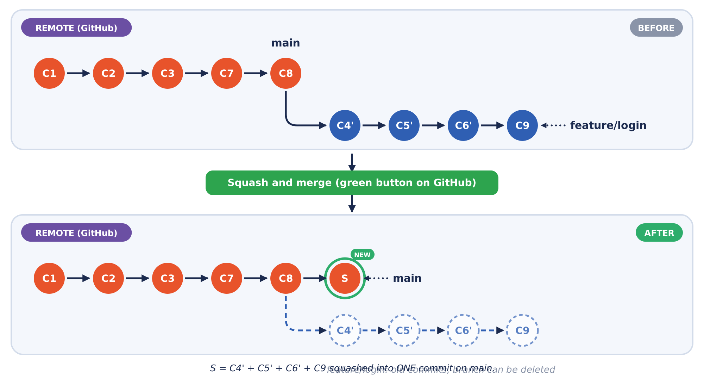](./images/14-step10-squash-merge.png)

*🔗 [Click to open Step 10 Squash & Merge diagram in full resolution](./images/14-step10-squash-merge.png)*

#### 🔍 Diagram Breakdown: Squash & Merge
- **BEFORE (Top)**: `feature/login` consists of four individual development commits (`C4'`, `C5'`, `C6'`, `C9`).
- **Action**: Click green button: **Squash and merge**.
- **AFTER (Bottom)**: All 4 commits are squashed together into a single atomic commit `S` (`S = C4' + C5' + C6' + C9`) on `main`.
- The intermediate commits are cleanly retired (dashed circles). `main` advances cleanly to `S`.

---

### 👁️ Picture & Link: Create a Merge Commit

[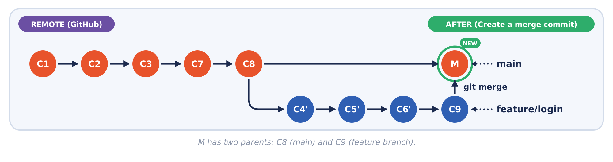](./images/15-step10-merge-commit.png)

*🔗 [Click to open Step 10 Merge Commit diagram in full resolution](./images/15-step10-merge-commit.png)*

#### 🔍 Diagram Breakdown: Merge Commit
- Retains all feature commits (`C4'`, `C5'`, `C6'`, `C9`) in their original state.
- Generates a new merge commit `M` (green ring, `NEW`) on `main` with two parent commits: `C8` and `C9`.

---

# STEP 11 — Update local `main` and clean up

### 🔧 Command

```bash
# Switch back to local main
git switch main

# Pull down the merged result from GitHub
git pull origin main

# Delete the local feature branch
git branch -d feature/login

# Delete the remote branch on GitHub (or click "Delete branch" button in the PR)
git push origin --delete feature/login

# Prune stale tracking references from your local cache
git fetch --prune
```

> 💡 **Tip:** If Git warns you that `-d` cannot delete the branch after a **squash merge** (because the individual commit hashes were replaced by squash commit `S`), use uppercase force-delete: `git branch -D feature/login`.

### 💬 In plain words
Your feature is now permanently integrated into `main`. The temporary feature branch has completed its job and should be deleted to keep both local and remote repositories clean and organized.

### 👁️ Picture & Link

[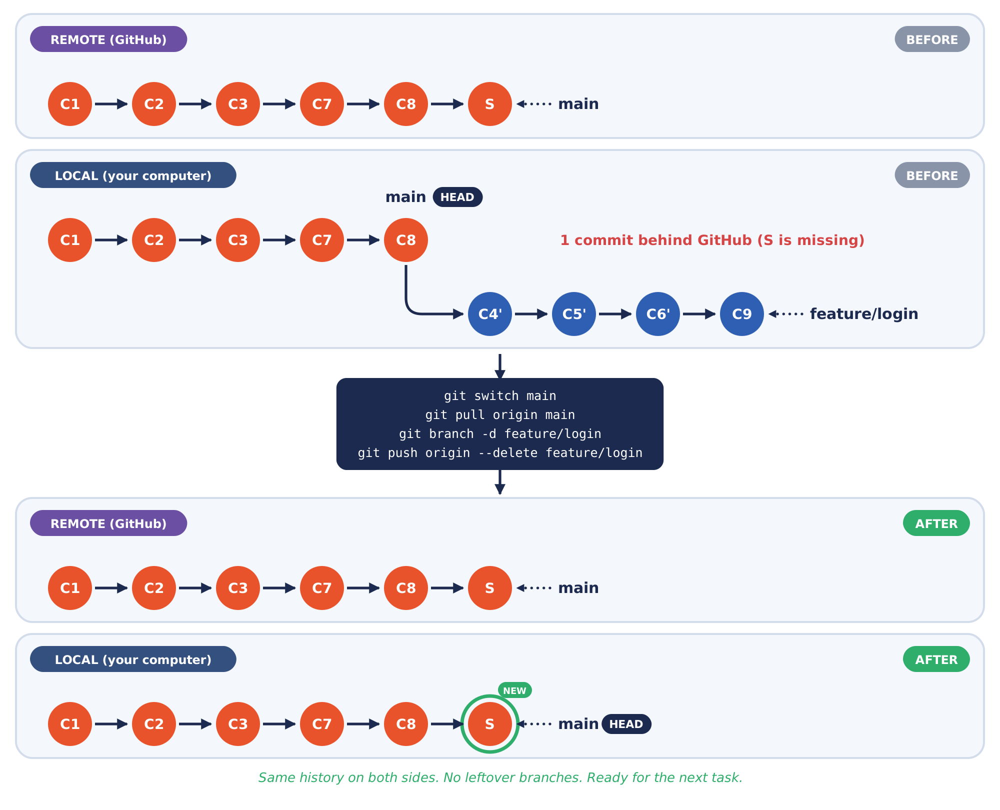](./images/16-step11-cleanup.png)

*🔗 [Click to open Step 11 Cleanup diagram in full resolution](./images/16-step11-cleanup.png)*

#### 🔍 Diagram Breakdown & Final State
- **BEFORE (Top half)**:
  - REMOTE (GitHub): `main` is at `S`.
  - LOCAL: `main` is still at `C8` ("1 commit behind GitHub (S is missing)"). Both local and remote still have the old `feature/login` branch.
- **Commands**:
  - `git switch main` and `git pull origin main` pull commit `S` into local `main`.
  - `git branch -d feature/login` and `git push origin --delete feature/login` remove the branch pointers.
- **AFTER (Bottom half)**:
  - Local `main` and Remote `main` are perfectly identical at commit `S`.
  - No leftover feature branches remain.
  - "Same history on both sides. No leftover branches. Ready for the next task."

---

# 🎬 The whole story in one picture

[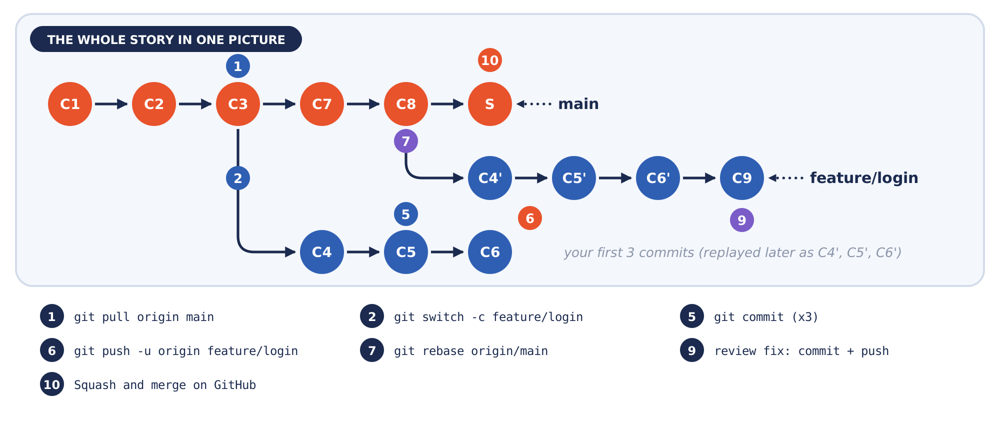](./images/17-whole-story.png)

*🔗 [Click to open the complete timeline diagram in full resolution](./images/17-whole-story.png)*

#### 🔍 Diagram Breakdown: Complete Visual Summary
This end-to-end diagram maps each workflow step along the timeline:
- **1 (`git pull origin main`)**: Start with an up-to-date `main` at `C3`.
- **2 (`git switch -c feature/login`)**: Branch off from `C3`.
- **5 (`git commit` x3)**: Build feature through commits `C4 → C5 → C6`.
- **6 (`git push -u origin feature/login`)**: Publish branch and set upstream link.
- **7 (Sync with main)**: Teammates added `C7 → C8`. Run `git merge origin/main` to bring in their work via a merge commit (or rebase to replay commits onto `C8` as shown in this diagram: `C4' → C5' → C6'`).
- **9 (Review fix)**: Review feedback addressed with commit `C9`.
- **10 (Squash and merge)**: Entire feature condensed into single commit `S` on `main`.

---

# 📋 Command Cheat Sheet (in order)

Keep this quick reference open during daily development:

```bash
# 1. Synchronize main with GitHub
git switch main
git pull origin main

# 2. Create and switch to your feature branch
git switch -c feature/my-task

# 3-5. Work, stage, and commit in small units
git status
git diff
git add .
git commit -m "feat: implement my task"

# 6. First push and configure upstream tracking
git push -u origin feature/my-task

# 7. Bring in latest teammate changes before PR (Merge)
git fetch origin
git merge origin/main
git push

# 8. Open Pull Request (via browser or GitHub CLI)
gh pr create --base main --head feature/my-task

# 9. Address reviewer comments
git add .
git commit -m "fix: address review comments"
git push

# 10. Merge PR on GitHub (Choose 'Squash and merge')

# 11. Synchronize and clean up
git switch main
git pull origin main
git branch -d feature/my-task
git push origin --delete feature/my-task
git fetch --prune
```

---

# 🏆 Golden Rules for High-Performing Teams

1. **Never commit directly to `main`.** Always branch and open a Pull Request.
2. **Pull before you branch.** Always start from the latest commit on `main`.
3. **One branch = one task.** Keep PRs focused, cohesive, and easy to review.
4. **Commit small and often.** Small, well-named commits make debugging simple.
5. **Push early.** Pushing your branch early allows teammates to monitor progress.
6. **Merge `main` before opening your PR.** Run `git fetch origin` then `git merge origin/main` to test your code on top of the newest `main` before asking for reviews.
7. **Avoid bare `git push --force`.** Standard `git push` is all you need when updating via merge.
8. **Never rewrite shared history.** Keep shared branches stable and reliable for the whole team.
9. **Require at least one peer approval.** Code review catches bugs and shares knowledge.
10. **Delete merged branches immediately.** Keep repository branch lists lean and organized.

---

# 🆘 Quick Troubleshooting Reference

| Problem | Safe Command to Run | What it Does |
|---|---|---|
| Which branch am I on? | `git branch` | Lists all local branches and flags active one with `*` |
| View commit graph visually | `git log --oneline --graph --all` | Displays an ASCII visual graph of all commits |
| Undo last commit, keep changes | `git reset --soft HEAD~1` | Removes commit snapshot while keeping code in staging |
| Discard uncommitted changes in a file | `git restore <file>` | Reverts file back to the last committed state |
| Unstage a staged file | `git restore --staged <file>` | Moves file from staging area back to working directory |
| Stash work temporarily | `git stash` ➜ later: `git stash pop` | Shelves uncommitted work safely to switch branches |
| Push rejected (behind remote) | `git pull --rebase` then `git push` | Pulls upstream commits first, then pushes your commits |
| Abort a messy rebase or merge | `git rebase --abort` / `git merge --abort` | Immediately returns repository to the exact state before the operation |
| Clean up stale remote branches | `git fetch --prune` | Removes deleted remote branches from your local cache |
