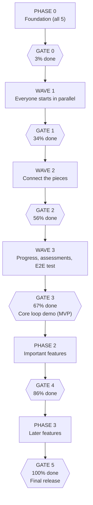

# Team Workflow Checklist (Detailed): Who Does What, in Which Order, and Why

A step-by-step flow for five members. Every task has a deep explanation (what it is, how it looks on the website, the logic behind the scenes, what to watch out for) and a checklist. After every wave you will find an estimated **progress percentage**.

**How to use this file**
- Work **top to bottom**. Each section ends with a **Gate**: a short checkpoint where the whole team confirms before moving on.
- Never start a task whose **Needs** item is not merged. Use a **fake** of the missing interface instead (see section 9).
- One task = one branch = one small PR = one reviewer from another member.
- Endpoint names and thresholds in this file are **suggestions** to discuss and confirm in your team.

**Members**

| | Area | Name |
|---|---|---|
| **Member 1** | Identity, Admin, Notifications | ______ |
| **Member 2** | Children, Directory, Links | ______ |
| **Member 3** | Exercise authoring | ______ |
| **Member 4** | Child practice, Progress | ______ |
| **Member 5** | Content, Shared services, Community | ______ |

---

## Table of Contents

1. [The whole flow at a glance](#1-the-whole-flow-at-a-glance)
2. [Phase 0: Foundation](#2-phase-0-foundation-all-five-before-anything-else)
3. [Wave 1: Everyone starts in parallel](#3-wave-1-everyone-starts-in-parallel)
4. [Wave 2: Connect the pieces](#4-wave-2-connect-the-pieces)
5. [Wave 3: Progress, assessments, end-to-end test](#5-wave-3-progress-assessments-end-to-end-test)
6. [Phase 2: Important features](#6-phase-2-important-features)
7. [Phase 3: Later features](#7-phase-3-later-features-only-if-time-allows)
8. [Handoff table](#8-handoff-table-when-x-merges-y-starts)
9. [Rules for working in parallel](#9-rules-for-working-in-parallel)
10. [Routines](#10-routines)
11. [How the percentages were estimated](#11-how-the-percentages-were-estimated)

---

## 1. The whole flow at a glance



### Progress overview

```text
Phase 0  [█░░░░░░░░░░░░░░░░░░░]   3%
Wave 1   [███████░░░░░░░░░░░░░]  34%   cumulative
Wave 2   [███████████░░░░░░░░░]  56%   cumulative
Wave 3   [█████████████░░░░░░░]  67%   cumulative   <-- MVP: the full recovery loop works
Phase 2  [█████████████████░░░]  86%   cumulative
Phase 3  [████████████████████] 100%   cumulative
```

### Who is busy when

```text
            Phase 0     Wave 1          Wave 2              Wave 3            Phase 2          Phase 3
Member 1    setup       T1.1 Auth       T1.2 T1.3 T1.4      T1.5              T1.6 Notif.      T1.7 Analytics
Member 2    DB rules    T2.1 T2.2       T2.3 Link           help + T2.4       T2.4 T2.5        T2.6 Quiz
Member 3    shared      T3.1 T3.2       T3.3 T3.4           help + T3.5       T3.5 Library     T3.6 Templates
Member 4    reference   T4.1            T4.2                T4.3 T4.4         T4.5 Points      T4.6 Streaks
Member 5    UI base     T5.1 T5.2       support             T5.3 E2E test     T5.4 T5.5        T5.6 Community
```

---

## 2. PHASE 0: Foundation (all five, before anything else)

Each item has one owner, but everyone reviews everyone's PR.

### What each item is and why it matters

| Item | Owner | What it means in practice | Why it matters |
|---|---|---|---|
| Solution and projects | Member 1 | Create the Domain, Application, Infrastructure, API and test projects with the correct references (inner layers never reference outer ones) | Everything else is built on this structure |
| Base classes, DI, exception middleware, validation | Member 1 | `BaseEntity`, the two `DependencyInjection.cs` files, one middleware that turns exceptions into 400, 403, 404, 409, 500 responses, validator registration | Every feature reuses them, so errors look the same everywhere |
| No-op `INotificationPublisher` | Member 1 | An interface plus an empty implementation that does nothing | Handlers can call it from day one; the real version arrives in T1.6 without changing handlers |
| Database and first migration | Member 2 | Everyone can run `dotnet ef database update` locally and get the same schema | Avoids "works on my machine" |
| Migration rules in README | Member 2 | Pull `main` first, never edit a merged migration, delete and regenerate yours on conflict | Migrations are the number one source of merge pain |
| Exercise-related interfaces declared | Member 3 | The "assigned exercises" query interface (shape only) | Member 4 can code against it before Member 3 finishes |
| File storage and TTS interfaces declared | Member 5 | `IFileStorageService` and `ITextToSpeechService` (shape only) | Member 3 can code the publish flow against them |
| Reference feature | Member 4 | One tiny feature (like "Add Child") built through all layers with tests | The template everyone copies, so five people write code in one style |
| Arabic-first RTL UI base | Member 5 | RTL layout, readable Arabic font with generous spacing, soft background colors, card components | The site itself must be friendly to people with reading difficulties |
| CI | All | On every PR: build, run tests, fail if anything breaks | Protects `main` |
| Git rules | All | Branch per task, small PRs, reviewer from another member, no direct push to `main` | Keeps five people from breaking each other's work |

### Checklist

- [ ] **Member 1:** Solution and projects with correct references
- [ ] **Member 1:** Base classes, DI registration files, exception middleware, validation setup
- [ ] **Member 1:** No-op `INotificationPublisher`
- [ ] **Member 2:** Database connection and first migration working on every machine
- [ ] **Member 2:** Migration rules written in the README
- [ ] **Member 3:** Exercise-related interfaces declared
- [ ] **Member 4:** Reference feature built across all layers as the template
- [ ] **Member 5:** File storage and text-to-speech interfaces declared
- [ ] **Member 5:** Arabic-first, RTL, reading-friendly UI base (if you have a frontend)
- [ ] **All:** CI builds and runs tests on every PR
- [ ] **All:** Git rules agreed

### GATE 0: Ready to split

- [ ] The solution builds with 0 errors on all five machines
- [ ] CI is green
- [ ] The reference feature is merged and everyone has read it
- [ ] Migration rules are in the README
- [ ] Each member knows their tasks

> ### Progress after Phase 0: about 3%
> ```text
> [█░░░░░░░░░░░░░░░░░░░]   3%
> ```
> **What exists:** an empty but solid skeleton. Nothing visible to users yet.

---

## 3. WAVE 1: Everyone starts in parallel

No member waits for another here. Use fakes where noted.

---

### Member 1: Identity

#### T1.1 Accounts, roles and authentication
**Needs:** Phase 0 | **Unblocks:** almost everything | **Priority:** highest, merge within the first days

**What it is:** The system that knows *who you are* and *what you are allowed to do*. Every other feature asks "who is calling?" and "may they do this?"

**On the website:**
- A visitor clicks **Register** and chooses **Parent**, **Specialist** or **Doctor**.
  - A **parent** fills name, email, password and is active immediately.
  - A **specialist or doctor** fills the same plus professional details (specialty, years of experience, and credential information so the admin has something to check; confirm what credentials to collect). Their account is created as **Pending**.
- **Login** with email and password leads to the correct home screen per role (parent dashboard, specialist workspace, doctor workspace, admin console).
- Admin accounts are never self-registered (see T1.4).

**Behind the scenes:**
- Store a **password hash** (never the password). ASP.NET Core Identity or a vetted hashing algorithm is fine.
- Roles: Parent, Child, Specialist, Doctor, Admin.
- Login returns a **JWT** with the user id and role. Keep the token short-lived.
- `ICurrentUserService` reads the token and exposes `UserId`, `Role`, `IsVerified` to every handler.
- **Authorization policies:** `ParentOnly`, `ChildOnly`, `SpecialistOnly`, `DoctorOnly`, `AdminOnly`, and `VerifiedProfessional` (specialist or doctor whose status is Approved).
- For `VerifiedProfessional`, **check the approval status from the database**, not only from the token. Otherwise a professional approved a minute ago still looks unverified until they log in again.

**Suggested endpoints:** `POST /api/auth/register/parent`, `POST /api/auth/register/professional`, `POST /api/auth/login`, `GET /api/auth/me`

**Watch out:** Email must be unique. Use clear 401 (not logged in) vs 403 (logged in but not allowed). Never put sensitive data in the token.

**Checklist**
- [ ] Register parent, specialist, doctor
- [ ] Login with JWT containing the role
- [ ] `ICurrentUserService` (UserId, Role, IsVerified)
- [ ] Policies: Parent, Specialist, Doctor, Admin, VerifiedProfessional
- [ ] Tests: 401 and 403 behave correctly
- [ ] **Handoff:** tell the team in chat the moment it merges so they replace their fake `ICurrentUserService`

---

### Member 2: Children and Directory

#### T2.1 Parent and child profiles
**Needs:** T1.1 (use a fake `ICurrentUserService` until merged) | **Unblocks:** T1.2, T2.3

**What it is:** The parent's "My children" area. A parent can have several children, each with a profile that every later feature refers to.

**On the website:**
- After login the parent sees **My children**: one card per child (name, age, difficulty).
- **Add child:** name, birth date, learning difficulty (dyslexia, dysgraphia, dyscalculia, attention and processing), and login details for the child (username and a simple password or PIN).
- Tap a child to edit the profile, see links, see progress (later).
- The parent can **deactivate** a child profile. Prefer a soft delete so past results are not lost.

**Behind the scenes:**
- `Child` entity: `ParentId`, `Name`, `BirthDate`, `LearningDifficulty` (stored as a field, per the design note, so adding a difficulty later does not need a redesign), `IsActive`.
- Creating a child also creates the child's account (agree the contract with Member 1 for T1.2).
- **Every query filters by the current parent's id** (rule 5). If a parent requests another family's child, return **404** so you do not reveal the child exists.
- The difficulty is what the parent or doctor *reported*, never a diagnosis made by the platform (rule 1). Label it accordingly.

**Suggested endpoints:** `POST /api/children`, `GET /api/children`, `GET /api/children/{id}`, `PUT /api/children/{id}`, `DELETE /api/children/{id}` (soft)

**Watch out:** Store only what you need about children (privacy). Child usernames must be unique.

**Checklist**
- [ ] Add, edit, list children (name, birth date, learning difficulty field)
- [ ] Parent sees only their own children (rule 5)
- [ ] Child account created with the child profile
- [ ] Uses a fake `ICurrentUserService` until T1.1 merges

#### T2.2 Professional profiles and public directory
**Needs:** T1.1; the "verified only" filter becomes real after T1.3

**What it is:** The "find a doctor" stage of the journey. Visitors and parents browse trusted professionals.

**On the website:**
- A **Directory** page anyone can open, no login required: cards showing photo (optional), name, role (doctor or specialist), specialty, years of experience, and later the average rating.
- **Search** by name, **filter** by specialty and by learning difficulty, with pagination.
- A **profile page** with the full bio and a **Choose this professional** button for logged-in parents (that button is built in T2.3).
- A professional edits their own profile from their workspace.

**Behind the scenes:**
- Profile data lives with the professional (display name, specialty, experience, bio, photo).
- The directory query returns **only Approved professionals** (rule 3). Filter in the **query**, not just in the UI, so a pending account can never leak through the API.
- Before T1.3 exists, use an `IsVerified` flag you set by hand in the database for testing.
- Leave a nullable rating field on the card, to be filled by T2.4.

**Suggested endpoints:** `GET /api/professionals?search=&specialty=&difficulty=&page=`, `GET /api/professionals/{id}`, `PUT /api/professionals/me`

**Watch out:** Directory and profile pages are public, so they must never include any child data.

**Checklist**
- [ ] Professional edits their profile (specialty, experience, bio)
- [ ] Public list with search and filter, visible without login
- [ ] "Verified only" filter in place (fully real after T1.3)

---

### Member 3: Exercise Authoring

> **Agree with Member 4 first:** an attempt stores a **snapshot** of the exercise (question, skill area, difficulty level, learning difficulty), so editing a published exercise never changes past results.

#### T3.1 Templates as data and exercise domain
**Needs:** Phase 0 | **Unblocks:** T3.2

**What it is:** The foundation of the exercise feature: what a *template* is, what an *exercise* is, and the lifecycle rules.

**On the website:** Nothing visible yet. The next task builds the form on top of this. Specialists will later see template cards ("Choose the correct spelling", "Listen and pick the word", ...).

**Behind the scenes:**
- **Template as data** (design note in the reference): a `Template` row holds a name, skill area, short description, the **field definitions** (which fields the form shows, required or not, help text) and a **layout key** (how the child's screen is drawn). A new exercise type later becomes a new row, not new code for the whole form.
- Seed the four starter templates: *Choose the correct spelling*, *Listen and pick the word*, *Letter and sound*, *Complete the word*.
- `Exercise` entity: specialist id, template id, title, learning difficulty, skill area, difficulty level (easy, medium, hard), question, options (2 to 4), correct option, audio source and audio file, private specialist note, status.
- **Entity rules live inside the entity:** `SaveDraft`/`UpdateDraft`, `Publish()` (strict checks), `Archive()`.
- **Lifecycle:** Draft → Published → Assigned → Completed. A clean way to model it: the *exercise* is Draft, Published or Archived, and each *assignment* (T3.4) is Assigned or Completed, because one exercise can be assigned to many children. Confirm this as a team.

**Suggested endpoints:** `GET /api/exercise-templates`, `GET /api/exercise-templates/{id}`

**Watch out:** Draft saving should be lenient (incomplete is fine); publishing must be strict. Keep those two validations separate.

**Checklist**
- [ ] Template entity with fields stored as data
- [ ] Four starter templates seeded
- [ ] Exercise entity with lifecycle rules
- [ ] Unit tests for the lifecycle and publish rules

#### T3.2 Exercise form: create, draft, preview
**Needs:** T3.1, T1.1 | **Unblocks:** T3.3

**What it is:** The screen where a verified specialist writes an exercise. It guides the specialist and keeps every exercise in the same structure.

**On the website (the specialist's journey, steps 1 to 4 of the reference):**
1. Open a child (or the library) and click **New exercise**.
2. Pick a **template**; the form opens with the right fields and short instructions.
3. Fill the fields: learning difficulty, skill area, difficulty level, title, question, 2 to 4 options, mark the **one** correct answer, audio source (generate, upload, or none), optional private note. Beside the form the specialist can see the child's **weak areas and latest assessment** (this panel is filled in once Member 4's tasks exist; until then show a placeholder).
4. Click **Preview** to see exactly what the child will see and hear.
5. Click **Save draft** to finish later.

**Behind the scenes:**
- The form is **generated from the template's field definitions**, so one backend handles all templates.
- **Draft validation (lenient):** only needs a title and template.
- **Publish validation (strict, used in T3.3):** required fields filled, question not empty, at least 2 options, no empty option, exactly one correct answer, skill area, level and type set (so progress tracking can use them).
- Only a **verified specialist** reaches this (rule 2). Specialists see and edit **only their own** drafts.
- The preview endpoint returns the child's view of the exercise (and can include the correct answer marker for the specialist).

**Suggested endpoints:** `POST /api/exercises` (create draft), `PUT /api/exercises/{id}` (update draft), `GET /api/exercises/{id}`, `GET /api/exercises/{id}/preview`, `GET /api/exercises?status=draft`

**Watch out:** A draft is never visible to any child. Return clear field-level errors so the form can highlight what is wrong.

**Checklist**
- [ ] Create from a template, save draft, edit draft
- [ ] Preview shows exactly what the child will see
- [ ] Validation: required fields, 2 to 4 options, no empty option, exactly one correct answer
- [ ] Only a verified specialist can use it (rule 2)

---

### Member 4: Progress Logic

> **Agree with Member 3 first:** the attempt snapshot fields (see above).

#### T4.1 Attempt and progress domain logic
**Needs:** Phase 0 (no other dependencies) | **Unblocks:** T4.2, T4.3

**What it is:** The "brain" of progress tracking, written as plain C# with no database, so it can be tested thoroughly before any screen exists.

**On the website:** Nothing visible. Later, parents and specialists see charts and lists powered by this logic.

**Behind the scenes:**
- `Attempt` entity: child id, assignment id, **exercise snapshot** (exercise id, question, skill area, level, learning difficulty), selected option, `IsCorrect`, score, time taken, submitted at.
- A calculator (pure functions) that, from a list of attempts, produces:
  - **Accuracy** = correct answers ÷ total answers.
  - **Per-skill accuracy** (spelling, reading, ...).
  - **Weak area:** a skill with accuracy below a threshold **and** a minimum number of attempts. Suggested starting point: below 60% with at least 5 attempts. The minimum matters: one wrong answer must not label a child as weak at something.
  - **Strong area:** a skill at or above a higher threshold (suggested 80%).
  - **Trend:** accuracy per week, or last N attempts compared with the N before. Output "improving", "stable" or "declining" plus the data points for a chart.
- Keep thresholds in one configuration object. Confirm the numbers with a specialist, since the reference defines a weak area as "consistently low".

**Watch out:** Handle empty lists and a single attempt without crashing or showing nonsense.

**Checklist**
- [ ] Attempt entity with exercise snapshot
- [ ] Pure logic: score, accuracy, completion
- [ ] Pure logic: strong and weak areas, trend over time
- [ ] Unit tests with sample data (including empty and tiny datasets)

---

### Member 5: Content and Shared Services

#### T5.2 File storage and text-to-speech
**Needs:** Phase 0 interfaces | **Unblocks:** T3.3 (do this early)

**What it is:** Two technical services other features rely on: saving files, and turning Arabic text into spoken audio.

**On the website:** Invisible by itself. It is what lets a child press a speaker button and hear the question.

**Behind the scenes:**
- `IFileStorageService`: save a file (stream, file name, content type, folder) and get back a reference; read it back; delete it. A **local disk** implementation is fine for the project. Validate allowed types (mp3, wav, m4a for audio) and a maximum size.
- `ITextToSpeechService`: takes text and a language and returns audio bytes plus content type. Choose a provider that supports **Arabic voices** (several cloud text-to-speech services do; check current dialect options, quality and pricing or free tier yourself).
- **Test with real exercise content early.** Arabic text without diacritics (tashkeel) can be pronounced incorrectly, which is a serious problem for spelling and reading exercises. Try the same words with and without diacritics and decide how specialists should write questions.
- API keys go in configuration or environment variables, never in the repository.
- Also write a **fake** TTS and storage implementation for tests.

**Watch out:** TTS calls can fail or be slow. Add timeouts and clear errors so T3.3 can offer "retry" or "publish without audio".

**Checklist**
- [ ] `IFileStorageService` implemented (local disk is fine)
- [ ] `ITextToSpeechService` implemented with a provider that supports Arabic voices
- [ ] Pronunciation quality tested on real Arabic sentences
- [ ] Test: Arabic sentence in, stored audio file out, read back
- [ ] Fakes for tests

#### T5.1 Knowledge Center
**Needs:** T1.1 for the admin role (stub until merged)

**What it is:** The awareness stage: reliable Arabic information about reading and learning difficulties. It can be built by Member 5 alone, so it never blocks anyone.

**On the website:**
- A **Knowledge Center** page for everyone, no login: cards for articles, FAQs, parent guides, specialist guides, case studies, and tips for teachers and parents.
- **Filter** by difficulty (dyslexia, dysgraphia, dyscalculia, attention and processing) and by type; **search**; short scannable text blocks, not long walls of text.
- Each article ends with a note: "This is information, not a diagnosis. Talk to a doctor," with a link to the directory (rule 1).
- **Admin side:** create, edit, publish, unpublish and delete content, with a draft state.

**Behind the scenes:**
- `Article`: title, slug, summary, body, type, difficulty, category, published flag, created by, dates.
- Public endpoints return only published content; admin endpoints are protected by the Admin policy.
- If the body is rich text or HTML, **sanitize it** before saving or rendering to prevent script injection.
- The reference requires coverage of **every difficulty**: add a small admin check showing how many articles exist per difficulty.
- Seed a few real Arabic articles per difficulty so the page is never empty in demos.

**Suggested endpoints:** `GET /api/articles?difficulty=&type=&search=`, `GET /api/articles/{slug}`, `POST/PUT/DELETE /api/admin/articles`, `POST /api/admin/articles/{id}/publish`

**Checklist**
- [ ] Admin creates, edits, deletes content (articles, FAQs, guides, case studies, tips)
- [ ] Content tagged by difficulty and category
- [ ] Visitors and parents read and filter without login
- [ ] Content never presents a diagnosis (rule 1)

---

### GATE 1: Wave 1 complete

- [ ] T1.1 merged, and **every member replaced their fake current-user service with the real one**
- [ ] T5.2 merged and the Arabic audio sample sounds acceptable
- [ ] T3.2 merged; Member 3 and Member 4 confirmed the snapshot shape
- [ ] T2.1, T2.2, T3.1, T4.1, T5.1 merged
- [ ] All PRs reviewed by someone other than the author
- [ ] CI green, no open migration conflicts

> ### Progress after Wave 1: about 34% (cumulative)
> ```text
> [███████░░░░░░░░░░░░░]  34%
> ```
> **Done in this wave:** about 31% of the total work (8 tasks).
> **What works on the website now:**
> - Users can register and log in with roles.
> - Parents can add and manage children.
> - Visitors can read the Knowledge Center and browse the directory (it will be empty until professionals are verified, or you flag test accounts by hand).
> - Specialists can create template-based exercise **drafts** and preview them, but cannot publish yet.
> - Arabic audio can be generated in a test, but no exercise uses it yet.
> - Progress logic exists and is unit-tested, but has no screens.

---

## 4. WAVE 2: Connect the pieces

---

### Member 1: Verification and Admin

#### T1.2 Child login
**Needs:** T1.1, T2.1

**What it is:** Lets a child sign in without an email address, on a very simple screen.

**On the website:**
- The home page has a clearly separate **Child login** button.
- The child types the **username** and **password or PIN** the parent created in T2.1.
- After login the child sees only their own simple home screen. There are no menus for parents or professionals.
- A parent can **reset** the child's PIN from the child's profile (coordinate the endpoint with Member 2).

**Behind the scenes:**
- Child accounts have the `Child` role and a `ChildId` claim linking the account to the profile.
- Lock the account for a few minutes after repeated failed logins.
- A child token only works on child endpoints; child tokens get **403** on parent and professional endpoints (rule 6: children cannot contact professionals or use the community).

**Suggested endpoints:** `POST /api/auth/child-login`

**Checklist**
- [ ] Child logs in with simple credentials and gets the Child role
- [ ] Child gets 403 on parent and professional endpoints
- [ ] Failed-attempt lockout
- [ ] PIN reset path agreed with Member 2

#### T1.3 Admin verification of professionals
**Needs:** T1.1

**What it is:** The trust gate. A professional can only use the platform's professional features after an admin confirms their credentials.

**On the website:**
- A professional registers and sees a **"Your account is waiting for approval"** screen. They can log in but cannot do anything professional.
- The admin has a **Pending professionals** page listing each applicant with their details and credentials, and two buttons: **Approve** and **Reject** (rejection requires a reason).
- Approved professionals appear in the directory and can use professional features. Rejected professionals see the reason (decide whether they can resubmit).

**Behind the scenes:**
- A verification status on the professional: Pending, Approved, Rejected (plus reason, reviewed by, reviewed at).
- The `VerifiedProfessional` policy (from T1.1) checks this status.
- Rule 3: unverified accounts **do not appear in the directory and cannot see any child**. Test both.
- Every approval or rejection writes an audit log entry (T1.4) and will trigger a notification in T1.6.

**Suggested endpoints:** `GET /api/admin/professionals?status=pending`, `POST /api/admin/professionals/{id}/approve`, `POST /api/admin/professionals/{id}/reject`

**Watch out:** Decide what happens if an approved professional is later suspended: their active links stay in the database, but access must stop immediately (check the status on every request).

**Checklist**
- [ ] Pending list; approve or reject with a reason
- [ ] Unverified professionals blocked from professional features (rule 3)
- [ ] **Handoff:** tell Member 2 so the directory filter uses the real flag

#### T1.4 Admin seed and audit log
**Needs:** T1.1

**What it is:** A safe way to create the first admin, and a record of everything admins do (the reference says all admin actions are logged).

**On the website:** The admin console has an **Audit log** page: a filterable table (who, what, on whom, when).

**Behind the scenes:**
- The admin account is seeded at startup from **configuration or environment variables**. Never commit an admin password to the repository.
- `AuditLogEntry`: admin id, action, target type, target id, details, UTC time.
- An `IAuditLogger` interface in Application, implemented in Infrastructure, called by admin handlers (verify, disable user, moderate content). Every later admin feature uses it.

**Suggested endpoints:** `GET /api/admin/audit-logs?adminId=&action=&from=&to=`

**Checklist**
- [ ] Seeded admin account from configuration
- [ ] Every admin action recorded (who, what, when)
- [ ] Audit log viewer endpoint

---

### Member 2: The Link

#### T2.3 Parent-to-professional link
**Needs:** T2.1, T2.2, T1.3 | **Unblocks:** T3.4, T4.3, T4.4, T5.4, and every permission check

**What it is:** The most important permission rule in the system. A professional can see a child **only** through a link the parent created by choosing them (rules 4 and 5).

**On the website:**
- A parent opens a professional's profile (or their child's page) and clicks **Choose this professional for [child name]**.
- The child's page shows **Linked professionals**, with a button to **end** a link. Ending removes that professional's access immediately.
- A professional has **My children**: a list of linked children with basic info (name, age, difficulty), and from there they open the child's case.

**Behind the scenes:**
- `ChildProfessionalLink`: child id, professional id, created by parent id, status (Active or Ended), dates. Only one **active** link per child and professional.
- A child can have several professionals (for example one doctor and one specialist).
- Only **Approved** professionals can be linked.
- **`IChildAccessChecker`** is the key piece others depend on:
  - `IsParentOf(parentId, childId)`
  - `IsLinked(professionalId, childId)`
  Every handler that touches child data calls it. That is how rules 4 and 5 are enforced in one place.
- Doctors and specialists both link the same way, but only specialists can create exercises (rule 2).

**Suggested endpoints:** `POST /api/children/{childId}/links`, `DELETE /api/children/{childId}/links/{linkId}`, `GET /api/children/{childId}/links`, `GET /api/professionals/me/children`

**Watch out:** Publish the `IChildAccessChecker` interface and an implementation as early as possible, even before the rest is polished, because three other members are waiting on it.

**Checklist**
- [ ] Parent chooses a doctor or specialist for a child
- [ ] Link entity with active and ended states
- [ ] Professional's "my children" list
- [ ] `IChildAccessChecker`: `IsParentOf` and `IsLinked`
- [ ] A professional sees only linked children (rule 4)
- [ ] **Handoff:** publish `IChildAccessChecker` as soon as it exists

---

### Member 3: Publish and Assign

#### T3.3 Publish and audio
**Needs:** T3.2, T5.2 | **Unblocks:** T3.4

**What it is:** Turns a draft into a real, child-ready exercise, and creates the audio.

**On the website:**
- On a finished draft the specialist clicks **Publish**.
- A small panel asks for the **audio source**: **Generate** (default), **Upload a recording**, or **No audio**.
- If generation works the specialist sees a success message with a **play** button to hear the result.
- If generation fails the specialist sees a clear message with **Retry** and **Publish without audio**. The work is never lost.

**Behind the scenes:**
1. Run the **strict checks** (required fields, options, exactly one correct answer, tags set).
2. Resolve audio:
   - *Generate:* send the question text to `ITextToSpeechService` (Arabic), store the result with `IFileStorageService`, save the file reference on the exercise.
   - *Upload:* the specialist uploads first; validate type and size, store it, link it.
   - *None:* skip.
3. Only after audio is resolved, set the status to **Published**. If audio fails, the exercise **stays a draft**.

**Suggested endpoints:** `POST /api/exercises/{id}/publish`, `POST /api/exercises/{id}/audio` (upload)

**Watch out:** Publishing twice should not create two audio files. Calls to the TTS provider can be slow, so show a loading state. Later edits to the question text of a published exercise must regenerate the audio, or the child will hear an old question (handled in T3.5).

**Checklist**
- [ ] Publish runs the checks
- [ ] Audio via text-to-speech, uploaded recording, or none
- [ ] If audio fails: retry, or publish without audio; the draft is never lost

#### T3.4 Assign exercises
**Needs:** T3.3, T2.3 | **Unblocks:** T4.2

**What it is:** Sends a published exercise to one or more of the specialist's linked children (steps 3 and 4 of the recovery loop).

**On the website:**
- On a published exercise (or in the library) the specialist clicks **Assign**.
- A checklist shows **only their linked children**; they select one or more and confirm.
- The child gets a notification (T1.6) and the exercise appears on the child's home screen.
- On a child's page the specialist sees which exercises are assigned and which are completed.

**Behind the scenes:**
- `Assignment`: exercise id, child id, assigned by, assigned at, status (Assigned or Completed).
- For every selected child call `IsLinked(specialistId, childId)`. If **any** child is not linked, reject the whole request and list the invalid ones (rules 2 and 4).
- The same exercise can be assigned again later (for example for practice), creating a new assignment.
- Provide the "assigned exercises" query for the child (the contract with Member 4).

**Suggested endpoints:** `POST /api/exercises/{id}/assign`, `GET /api/children/{childId}/assignments`

**Checklist**
- [ ] Assign to one or more linked children
- [ ] Assigning to an unlinked child is rejected (rule 4)
- [ ] Child's assigned-exercises query available for Member 4
- [ ] **Handoff:** tell Member 4 when the query merges

---

### Member 4: Child Solves

#### T4.2 Child solves exercises
**Needs:** T3.4, T1.2 (use fakes until merged)

**What it is:** The child's side of the recovery loop (steps 4 to 6): receive, listen, solve, submit, get a result.

**On the website:**
- After child login the home screen shows the **assigned exercises** as big, friendly, game-like cards.
- Opening one shows the **question**, a large **speaker button** to listen, and **large option buttons**.
- The child taps an answer and presses **Submit**, then sees **friendly feedback** (a correct answer, or a gentle "let's try the next one") and their score. The tone must feel like a game, not a test.

**Behind the scenes:**
- One exercise is one question, so one attempt = one answer. Decide whether a child gets **one attempt per assignment** (recommended; the specialist can reassign to repeat).
- **The server decides correctness.** The correct answer is **never sent to the child's browser** before they submit.
- On submit: verify the assignment belongs to this child and is still open, compare to the correct option, save an `Attempt` with the exercise snapshot, mark the assignment **Completed**, and publish the "child finished" event.
- Ignore a second submit for the same assignment (double taps, reconnects).
- Audio files should be served through an authorized endpoint so children cannot guess other children's audio URLs.

**Suggested endpoints:** `GET /api/me/assignments`, `GET /api/me/assignments/{id}`, `POST /api/me/assignments/{id}/submit`

**Checklist**
- [ ] Child sees their assigned list
- [ ] Open an exercise with its audio
- [ ] The correct answer is never sent to the client before submit
- [ ] Submit an answer, score it, mark the assignment completed
- [ ] A child sees only their own assignments

---

### Member 5: Support

- [ ] Review PRs from Members 1 to 4 (you have the most capacity)
- [ ] Prepare the demo seed data design for T5.3 (verified specialist, parent, child, exercises, articles)
- [ ] Help whichever member is behind

---

### GATE 2: Wave 2 complete

- [ ] T1.2, T1.3, T1.4, T2.3, T3.3, T3.4, T4.2 merged
- [ ] Rules 2, 3, 4, 5 each have a passing test
- [ ] Manual check: a verified specialist creates, publishes and assigns an exercise to a linked child, and the child solves it
- [ ] All fakes replaced with real implementations
- [ ] CI green

> ### Progress after Wave 2: about 56% (cumulative)
> ```text
> [███████████░░░░░░░░░]  56%
> ```
> **Done in this wave:** about 22% of the total work (7 tasks).
> **What works on the website now:**
> - The admin approves professionals, and approved ones appear in the directory.
> - A parent links a child to a professional.
> - A specialist publishes an exercise with audio and assigns it to a linked child.
> - The child logs in, listens, solves and submits; results are stored.
> - **Missing:** no progress screens for parents or specialists, and no assessments yet.

---

## 5. WAVE 3: Progress, assessments, end-to-end test

---

### Member 1

#### T1.5 Admin user management basics
**Needs:** T1.3

**What it is:** Lets the admin find users and stop a problem account.

**On the website:** An admin **Users** page: a table with search and filter by role and status, with **Disable** and **Enable** buttons and a required reason.

**Behind the scenes:**
- An `IsActive` flag on users. A disabled user cannot log in, and **existing tokens must stop working** too: either keep tokens short-lived or check `IsActive` on each request.
- An admin cannot disable their own account.
- Every action is written to the audit log (T1.4).
- This is also the tool the admin uses later to act on community reports (T5.6).

**Suggested endpoints:** `GET /api/admin/users?role=&status=&search=`, `POST /api/admin/users/{id}/disable`, `POST /api/admin/users/{id}/enable`

**Checklist**
- [ ] List and search users
- [ ] Disable or enable an account
- [ ] A disabled user can no longer log in
- [ ] Actions audited

### Member 2 (start Phase 2 early)

- [ ] Help Member 4 verify that parents see the correct progress for their own child
- [ ] Start **T2.4 Ratings and reviews** (see section 6)

### Member 3 (start Phase 2 early)

- [ ] Start **T3.5 Exercise library** (see section 6)

---

### Member 4

#### T4.3 Progress tracking endpoints
**Needs:** T4.1, T4.2, T2.3

**What it is:** Turns raw attempts into something a parent or specialist can understand (steps 7 and 8 of the loop).

**On the website:**
- **Parent:** on a child's page, a simple **progress dashboard**: how many exercises were assigned and completed, overall accuracy, a bar per skill area, and a trend line. Colors should be calm and easy to read; strong and weak areas are labeled in plain language.
- **Specialist:** the same view plus a list of recent attempts (including wrong answers) to plan the next exercise.

**Behind the scenes:**
- The summary is computed with the calculator from T4.1: totals, completion rate, overall accuracy, accuracy per skill area, strong areas, weak areas, weekly trend, recent attempts. Computing it on the fly is fine for a project of this size.
- **Who may read it:** the child's parent (`IsParentOf`) and linked professionals (`IsLinked`). Everyone else gets 403 (rules 4 and 5).
- Show a friendly **empty state** when there is no data yet.
- Also expose the weak areas for the exercise form's side panel (T3.2).

**Suggested endpoints:** `GET /api/children/{childId}/progress?from=&to=`, `GET /api/children/{childId}/attempts`

**Checklist**
- [ ] Per-child summary: score, accuracy, completion
- [ ] Strong and weak areas
- [ ] Trend over time
- [ ] Readable by the parent (own child) and linked professionals
- [ ] Unauthorized users get 403; numbers match the database

#### T4.4 Assessments
**Needs:** T2.3

**What it is:** The specialist's written findings about a child: strengths, weak areas and recommendations.

**On the website:**
- On a child's page the specialist clicks **New assessment** and fills **findings**, **weak areas** (pre-filled from progress, editable), **strong areas**, and **recommendations**.
- The page shows the **assessment history**, newest first. The latest one also appears beside the exercise form (T3.2) to help target exercises.
- A visible reminder: *this is a skills assessment, not a medical diagnosis* (rule 1).

**Behind the scenes:**
- `Assessment`: child id, specialist id, findings, weak areas, strong areas, recommendations, date.
- Recommended: make assessments **append-only** (a new record each time, no overwriting) so the history of the child's recovery is preserved.
- Only a **linked specialist** can write. The reference says assessments are used by **Specialist and Doctor**, so linked doctors can read them. Decide with the team whether parents see them or only get a notification and the recommendations.
- Publish a "new assessment" event for notifications.

**Suggested endpoints:** `POST /api/children/{childId}/assessments`, `GET /api/children/{childId}/assessments`, `GET /api/children/{childId}/assessments/latest`

**Checklist**
- [ ] Specialist records findings, weak areas, recommendations for a linked child
- [ ] Confirmed who may read it
- [ ] Only the linked specialist can write

---

### Member 5

#### T5.3 Seed data and end-to-end test
**Needs:** T1.3, T2.3, T3.4, T4.3

**What it is:** Demo data so the site is never empty, plus one automated test that proves the whole recovery loop works.

**On the website:** Nothing new visible, but with seed data your demo has real people and content to show.

**Behind the scenes:**
- A **development-only, repeatable seeder**: an admin, a verified specialist, a verified doctor, an unverified professional (to demonstrate rule 3), a parent with two children, links, several published exercises, and articles for every difficulty. Running it twice must not create duplicates.
- **The end-to-end test** (using the app's test host with a test database) walks the loop: register → admin verifies → parent adds child → parent links specialist → specialist creates, publishes and assigns an exercise → child logs in and submits → progress shows the result.
- Add **negative tests** for the permission rules: a parent cannot see another family's child, a professional cannot see unlinked children, an unverified professional is blocked, a child cannot call parent endpoints.

**Checklist**
- [ ] Demo data created, repeatable without duplicates
- [ ] One automated test runs the whole loop
- [ ] Negative tests for rules 2 to 5
- [ ] The test runs in CI

---

### GATE 3: Core loop demo (MVP)

- [ ] The end-to-end test passes in CI
- [ ] All five members watch one live demo of the whole recovery loop
- [ ] Rules 1 to 5 each verified with a test
- [ ] No known permission leaks (parent sees other parents' children, professional sees unlinked children, child sees others' data)
- [ ] Bug list written and prioritized
- [ ] Decide what Phase 2 items stay in scope

> ### Progress after Wave 3: about 67% (cumulative)
> ```text
> [█████████████░░░░░░░]  67%
> ```
> **Done in this wave:** about 11% of the total work (4 tasks).
> **What works on the website now: the full core journey (your MVP):**
> - Awareness: Knowledge Center and directory.
> - Guidance: register, add child, choose a professional.
> - Recovery: create, publish, assign, solve, **progress screens and assessments**.
> - Admin: verification, audit log, user management.
> - An automated end-to-end test protects it.
>
> This is the minimum that makes the project different from an information website. **Protect this gate: if time runs short, stop here and polish.**

---

## 6. PHASE 2: Important features

---

### Member 1

#### T1.6 Notifications
**Needs:** core phase

**What it is:** The platform tells people when something happens that needs them.

**On the website:** A **bell icon** with an unread count. Clicking it opens a list ("New exercise from your specialist", "Omar finished an exercise"). Clicking a notification opens the related page and marks it as read.

**Behind the scenes:**
- `Notification`: user id, type, message, target reference (what to open), `IsRead`, created at.
- Replace the no-op `INotificationPublisher` with the real one. Handlers already call it, so they do not change.
- Events and recipients:

| Event | Who is notified |
|---|---|
| Exercise assigned | The child |
| Child finished an exercise | The linked specialist |
| Verification result | The professional |
| New assessment | The parent (confirm what the parent may see) |
| Specialist replied to a question | The parent |

- Start simple: the page asks for the unread count on load and every so often. Real-time delivery can come later.
- **A failed notification must never make the main action fail.** Assigning an exercise should succeed even if the notification cannot be saved.
- Users only read their own notifications.

**Suggested endpoints:** `GET /api/notifications`, `GET /api/notifications/unread-count`, `POST /api/notifications/{id}/read`, `POST /api/notifications/read-all`

**Checklist**
- [ ] Real publisher replaces the no-op
- [ ] Events: new exercise, child finished, specialist replied, verification result, new assessment
- [ ] List and mark-as-read endpoints

### Member 2

#### T2.4 Ratings and reviews
**Needs:** T2.3

**What it is:** Parents who worked with a professional can rate them, helping other parents choose.

**On the website:**
- On the professional's profile a parent who has been linked to them sees **Write a review**: 1 to 5 stars and a comment.
- The profile and the directory card show the **average rating** and review count.
- Each review has a **Report** button.

**Behind the scenes:**
- `Review`: professional id, parent id, rating, comment, status (Visible or Hidden), dates.
- **Rule 7:** only a parent who has (or had) a link with that professional can review. One review per parent per professional (editing allowed).
- **Rule 8:** a reported review goes to the admin's queue. Agree one **generic `Report` model** (target type, target id, reason, reporter, status) with Member 5, because the community (T5.6) needs the same thing.
- The admin can hide the review or dismiss the report; action is audited.
- Update the average rating field left empty in T2.2.

**Suggested endpoints:** `POST /api/professionals/{id}/reviews`, `GET /api/professionals/{id}/reviews`, `POST /api/reviews/{id}/report`

**Checklist**
- [ ] Only parents linked to the professional can review (rule 7)
- [ ] Average rating on the profile and directory card
- [ ] Reviews can be reported (rule 8)

#### T2.5 Doctor view and medical notes
**Needs:** T2.3, T4.3

**What it is:** A doctor's workspace for medical follow-up of linked children.

**On the website:**
- The doctor's **My children** list opens a **case page**: child info, progress summary, assessment history, and a **Medical notes** section.
- The doctor writes a note and sees the history of their notes.
- Doctors do **not** see the exercise form (rule 2: only specialists create exercises).

**Behind the scenes:**
- `MedicalNote`: child id, doctor id, text, created at. Make notes append-only.
- Reuses the progress and assessment queries with the `IsLinked` check.
- Decide with the team who can read medical notes (suggested default: linked doctors only; the reference only says the doctor adds them).
- The platform itself never diagnoses (rule 1): the notes are the doctor's, not generated by the system.

**Checklist**
- [ ] Doctor sees linked children's progress and assessments
- [ ] Doctor adds notes
- [ ] Confirmed who may read medical notes

### Member 3

#### T3.5 Exercise library
**Needs:** T3.4

**What it is:** A specialist's saved exercises, so the same exercise is not written twice.

**On the website:**
- A **My exercises** page: a table or cards with search by title, filters (skill area, level, status), and actions on each exercise:
  - **Duplicate:** creates a copy as a new draft ("... (copy)") to adjust.
  - **Edit:** change a draft or a published exercise.
  - **Assign / reassign:** reuse the assign flow from T3.4.
  - **Archive:** removes it from the library and from new assignments; past results stay.

**Behind the scenes:**
- Reuses the exercise entity; adds search and filter queries, a duplicate command, and an archive command (status Archived).
- **Editing a published exercise:** completed attempts already store a snapshot, so past results stay correct. Exercises assigned but not yet solved will show the updated version.
- **If the question text of a published exercise changes, regenerate the audio**, otherwise the child hears the old question.
- Specialists only see their own library.

**Suggested endpoints:** `GET /api/exercises?search=&skillArea=&level=&status=&page=`, `POST /api/exercises/{id}/duplicate`, `POST /api/exercises/{id}/archive`

**Checklist**
- [ ] List own exercises, search, filter
- [ ] Duplicate and reuse
- [ ] Edit a published exercise (past attempts keep the version solved; audio regenerated if the question changed)
- [ ] Archive and reassign

### Member 4

#### T4.5 Points and badges
**Needs:** T4.2

**What it is:** Makes practice feel rewarding for the child.

**On the website:** After each exercise the child sees points earned, and a small celebration if a badge unlocks. A **My badges** screen shows collected badges and the ones still locked.

**Behind the scenes:**
- Starting rules to confirm (suggestion): points per correct answer, a smaller amount for completing an exercise, and badges such as "First exercise", "10 exercises done", "100 points".
- Store **badge definitions as data** (code, name, condition type, threshold) so adding a badge needs no new code.
- `PointsTransaction` (child, amount, reason, attempt) and `ChildBadge` (child, badge, awarded at) with a **unique constraint** so a badge is never awarded twice.
- Triggered after a submit in T4.2. Keep that handler simple: it calls one reward service.
- Be gentle: never take points away for a wrong answer.

**Suggested endpoints:** `GET /api/me/points`, `GET /api/me/badges`

**Checklist**
- [ ] Points per correct answer
- [ ] Badge rules as data
- [ ] Child can view their own points and badges

### Member 5

#### T5.4 Ask a Specialist
**Needs:** T2.3, T1.6

**What it is:** A parent asks a question and a specialist answers.

**On the website:**
- A parent opens **Ask a Specialist**, chooses a **category** (for example reading, spelling, writing, math, attention, general), writes the question, and sends it.
- The parent sees **My questions** with status (Open or Answered) and the answer when it arrives, and gets a notification.
- A specialist sees **Open questions** matching their categories and writes an answer.

**Behind the scenes:**
- `Question` (parent, category, title, body, status, dates) and `Answer` (question, specialist, body, date).
- Decide the routing as a team: an **open pool by category** (any verified specialist can answer) is the simplest; optionally let a parent direct the question to a linked specialist.
- Only verified specialists can answer (rule 3).
- Do not expose the child's identity to specialists who are not linked.
- Show a reminder that answers are guidance, not a diagnosis (rule 1).
- Answering triggers the notification event from T1.6.

**Suggested endpoints:** `POST /api/questions`, `GET /api/questions/mine`, `GET /api/questions/open`, `POST /api/questions/{id}/answers`

**Checklist**
- [ ] Parent sends a question under a category
- [ ] Specialist answers
- [ ] Parent is notified

#### T5.5 Dyslexia simulator
**Needs:** none

**What it is:** A short interactive experience that helps a visitor feel what reading can be like for a child with dyslexia. It is framed as a glimpse, not an exact replica.

**On the website:**
- A visitor opens **Try it yourself**, reads a short Arabic text while the display behaves in ways that mimic the difficulty (for example letters swapping, blurring or shifting), then sees a message explaining what they experienced, with links to the guide and parent tips.
- A visible **Stop** button must always be present.

**Behind the scenes:**
- This is mostly **frontend work**; the backend part is small (optionally serving the text and explanations from the Knowledge Center). Pair with whoever builds the frontend.
- Avoid rapid flashing effects (photosensitivity) and warn the visitor before starting.
- Test with connected Arabic letters so the effect stays readable enough to be meaningful.

**Checklist**
- [ ] Visitor experience framed as a glimpse, not a replica
- [ ] Stop button and no flashing
- [ ] Ends with links to the guide and tips

---

### GATE 4: Phase 2 complete

- [ ] Every Phase 2 task merged with tests
- [ ] Rules 7 and 8 verified
- [ ] Notifications fire for every listed event
- [ ] End-to-end test updated and still green
- [ ] Decide what Phase 3 items fit in the remaining time

> ### Progress after Phase 2: about 86% (cumulative)
> ```text
> [█████████████████░░░]  86%
> ```
> **Done in this phase:** about 19% of the total work (7 tasks).
> **What works on the website now:** everything in the MVP plus notifications, the exercise library, ratings and reviews, the doctor workspace, points and badges, Ask a Specialist and the simulator.

---

## 7. PHASE 3: Later features (only if time allows)

#### Member 1: T1.7 Analytics dashboard
- **What it is:** an admin overview of how the platform is used.
- **On the website:** an admin dashboard with number cards (users by role, verified professionals, children, exercises by status, assignments and completion rate) and a few charts over time (attempts per day, average accuracy).
- **Behind the scenes:** read-only **aggregate queries** (counts and groupings), no new entities. Only the Admin policy can access. Keep it fast with simple queries, optionally cached for a minute.
- **Endpoints:** `GET /api/admin/analytics/overview`, `GET /api/admin/analytics/timeseries?metric=`
- [ ] Overview numbers and time-series charts

#### Member 2: T2.6 Awareness quiz
- **What it is:** a short quiz for visitors and parents about what they have noticed in a child. It ends with guidance, **never a diagnosis** (rule 1).
- **On the website:** 8 to 10 simple questions (for example "Does the child often confuse similar letters?") with answers like yes, sometimes, no. The result page never says "you have" or "your child has". It says what was noticed, always ends with **"talk to a doctor,"** and links to the relevant guide articles and the directory.
- **Behind the scenes:** store questions as **data** with a category per question, so a specialist can change them without code. Evaluation is stateless (nothing saved for visitors). Questions and wording must be reviewed by a specialist.
- **Endpoints:** `GET /api/quiz`, `POST /api/quiz/evaluate`
- [ ] Questions as data, specialist-reviewed
- [ ] Result always ends with "talk to a doctor" and links

#### Member 3: T3.6 Templates for other difficulties
- **What it is:** exercise templates for writing (dysgraphia), math (dyscalculia), and attention and processing.
- **On the website:** the template picker in the exercise form shows new cards. Add **one template at a time**, each reviewed by a specialist.
- **Behind the scenes:** thanks to the "templates as data" design, a new template is mostly a **new seeded row** (fields, validation hints, layout key). A new layout key also needs a matching screen for the child (frontend). Add per-template validation (for example, "Complete the word" must contain a blank marker).
- [ ] One new template end to end (form, child screen, validation, tests)

#### Member 4: T4.6 Streaks and milestones
- **What it is:** rewards for practicing regularly.
- **On the website:** a flame or counter showing days in a row with at least one completed exercise, and milestone messages (for example 7 days, 50 exercises).
- **Behind the scenes:** compute from attempt dates using the **Egypt time zone** (store UTC, convert for the day boundary). Keep `ChildStreak` (current, longest, last activity date). Be gentle: when a streak breaks, show an encouraging "welcome back", never a punishment.
- [ ] Streak calculation with correct day boundaries
- [ ] Milestone messages

#### Member 5: T5.6 Community and moderation
- **What it is:** a space where parents support each other.
- **On the website:** parents see a feed of posts, can create posts, comment, like, and **report** content. The admin has a **moderation queue** of reports with a preview of the content and actions: hide content, dismiss the report, or disable the user (T1.5).
- **Behind the scenes:** `Post`, `Comment`, `Like` (unique per user and post), and the generic `Report` model shared with T2.4 (rule 8). **Parents only**: children are blocked (rule 6). Show a display name or alias rather than full names, remind users not to share children's names or photos, add pagination and simple rate limiting against spam. Needs a moderation view in the admin console (coordinate with Member 1).
- **Endpoints:** `GET/POST /api/community/posts`, `POST /api/community/posts/{id}/comments`, `POST /api/community/posts/{id}/like`, `POST /api/reports`, `GET /api/admin/reports`, `POST /api/admin/reports/{id}/resolve`
- [ ] Posts, comments, likes, reports
- [ ] Admin moderation queue
- [ ] Children cannot use it (rule 6)

---

### GATE 5: Final release

- [ ] All rules (1 to 8) verified with tests
- [ ] Full regression: end-to-end test and all unit and integration tests green
- [ ] Seed data and demo script ready
- [ ] README updated: how to run, how to migrate, architecture summary
- [ ] No open critical bugs

> ### Progress after Phase 3: 100% of the planned feature work
> ```text
> [████████████████████] 100%
> ```
> **Done in this phase:** about 14% of the total work (5 tasks).
> Remember that the percentages cover **feature work only**. Reserve extra time for bug fixing, polish, documentation and deployment (see section 11).

---

## 8. Handoff table: "When X merges, Y starts"

| When this merges | Tell | They can now |
|---|---|---|
| T1.1 Auth (Member 1) | Everyone | Replace the fake `ICurrentUserService` |
| T5.2 Storage and TTS (Member 5) | Member 3 | Start T3.3 audio publishing |
| T1.3 Verification (Member 1) | Member 2 | Make the directory filter real |
| T2.3 Link and `IChildAccessChecker` (Member 2) | Members 3, 4, 5 | Enforce rules 4 and 5, start T3.4, T4.3, T4.4 |
| T3.4 Assign (Member 3) | Member 4 | Finish T4.2 against real assignments |
| T4.3 Progress (Member 4) | Members 2, 5 | Start T2.5 and T5.3 |
| T1.6 Notifications (Member 1) | Member 5 | Start T5.4 Ask a Specialist |

---

## 9. Rules for working in parallel

- [ ] If a dependency is not merged, write a **fake** of its interface (for example a fake `IChildAccessChecker` that returns true) and keep working
- [ ] Replace the fake the same day the real one merges, and re-run your tests
- [ ] Never copy another member's code into your folder; ask them to merge the small piece first
- [ ] Edit shared files (`ApplicationDbContext`, the two `DependencyInjection.cs` files) in small commits and merge often
- [ ] Pull `main` before creating a migration; if two migrations collide, delete yours and regenerate it after rebasing
- [ ] Never edit a migration that is already merged

---

## 10. Routines

### Every task (Definition of Done)

- [ ] Domain: entity, rules and repository interface (if needed)
- [ ] Application: DTOs, command or query, validator, mapping, handler, DI registration
- [ ] Infrastructure: EF configuration, DbSet, repository, DI registration, migration
- [ ] API: controller action with correct authorization; exceptions mapped
- [ ] Unit tests for rules and handler; integration test for the endpoint
- [ ] Relevant rules from the reference (section 8) enforced and tested
- [ ] `dotnet build` has 0 warnings and 0 errors; `dotnet test` is green
- [ ] No inner layer references an outer layer
- [ ] PR reviewed by someone who did not write it

### Every week (15 to 20 minutes)

- [ ] Each member: what I finished, what I am doing, what blocks me
- [ ] Check the handoff table: does anyone need something from someone else this week?
- [ ] Review the board: is any task stuck for more than 3 days? If yes, pair up
- [ ] Rotate PR reviewers so everyone sees every layer
- [ ] Run the end-to-end test on `main` once
- [ ] Update the progress percentage in this file

### Reviewer rotation (suggested)

| Author | Reviewer this sprint |
|---|---|
| Member 1 | Member 2 |
| Member 2 | Member 3 |
| Member 3 | Member 4 |
| Member 4 | Member 5 |
| Member 5 | Member 1 |

Change the pairs every sprint.

---

## 11. How the percentages were estimated

Each task got a **relative effort weight** (a rough size, not hours). The percentage after a wave is the **cumulative weight finished ÷ total weight**.

| Stage | Tasks | Effort points | Cumulative points | Cumulative % |
|---|---|---|---|---|
| Phase 0 | Foundation | 5 | 5 | 3% |
| Wave 1 | T1.1, T2.1, T2.2, T3.1, T3.2, T4.1, T5.1, T5.2 | 50 | 55 | 34% |
| Wave 2 | T1.2, T1.3, T1.4, T2.3, T3.3, T3.4, T4.2 | 36 | 91 | 56% |
| Wave 3 | T1.5, T4.3, T4.4, T5.3 | 18 | 109 | 67% |
| Phase 2 | T1.6, T2.4, T2.5, T3.5, T4.5, T5.4, T5.5 | 31 | 140 | 86% |
| Phase 3 | T1.7, T2.6, T3.6, T4.6, T5.6 | 22 | 162 | 100% |

**Weights used:** T1.1 = 8, T1.2 = 3, T1.3 = 5, T1.4 = 3, T1.5 = 3, T1.6 = 6, T1.7 = 4 | T2.1 = 5, T2.2 = 5, T2.3 = 6, T2.4 = 4, T2.5 = 4, T2.6 = 3 | T3.1 = 6, T3.2 = 8, T3.3 = 7, T3.4 = 5, T3.5 = 6, T3.6 = 4 | T4.1 = 5, T4.2 = 7, T4.3 = 6, T4.4 = 4, T4.5 = 4, T4.6 = 3 | T5.1 = 6, T5.2 = 7, T5.3 = 5, T5.4 = 4, T5.5 = 3, T5.6 = 8.

### Workload balance per member (all phases)

| | Effort points | Share of total |
|---|---|---|
| Phase 0 (shared) | 5 | 3% |
| Member 1 | 32 | 20% |
| Member 2 | 27 | 17% |
| Member 3 | 36 | 22% |
| Member 4 | 29 | 18% |
| Member 5 | 33 | 20% |

### Important notes

- These are **estimates**. Re-weigh the tasks after the first wave, when you know how fast your team really works, and update the percentages.
- The percentages cover **feature work only**. They do **not** include bug fixing, polishing the Arabic UI, documentation, deployment, or exam and holiday weeks. A sensible reserve is **15 to 20% extra time** on top.
- **67% at Gate 3 is your MVP.** If time runs short, finishing Gate 3 and polishing it is better than half-finishing Phase 2.
- Member 3 carries the most weight in the core phase; Member 5 has the lightest core load, so Member 5 should help review and unblock others.
