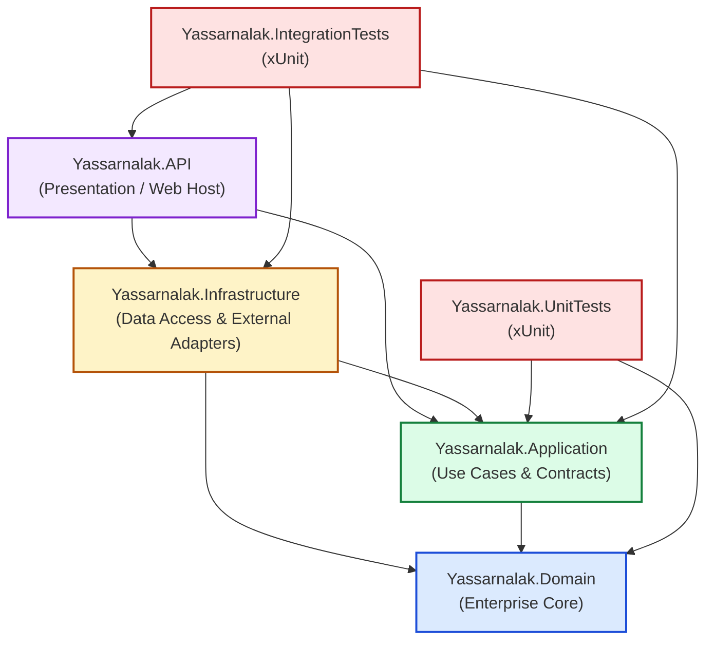
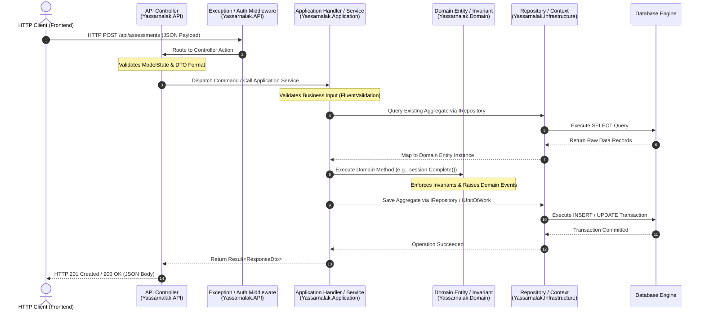

# Yassarnalak Platform - Backend Technical Architecture & Developer Reference

This document serves as the primary technical specification, architectural reference, and developer onboarding guide for the backend of the **Yassarnalak Platform**. Every backend developer is expected to understand and follow the patterns, directory boundaries, dependency rules, and coding standards outlined here.

---

## Table of Contents

1. [Project Overview](#1-project-overview)
2. [Technology Stack](#2-technology-stack)
3. [Complete Backend Architecture](#3-complete-backend-architecture)
4. [Complete Folder Structure Documentation](#4-complete-folder-structure-documentation)
   - [Domain Layer (`Yassarnalak.Domain`)](#domain-layer-yassarnalakdomain)
   - [Application Layer (`Yassarnalak.Application`)](#application-layer-yassarnalakapplication)
   - [Infrastructure Layer (`Yassarnalak.Infrastructure`)](#infrastructure-layer-yassarnalakinfrastructure)
   - [API / Presentation Layer (`Yassarnalak.API`)](#api--presentation-layer-yassarnalakapi)
   - [Test Projects (`tests/`)](#test-projects-tests)
5. [Project Files Documentation](#5-project-files-documentation)
6. [Project Dependency Rules](#6-project-dependency-rules)
7. [Application Request Lifecycle](#7-application-request-lifecycle)
8. [How to Add a New Feature (Developer Walkthrough)](#8-how-to-add-a-new-feature-developer-walkthrough)
9. [Database Architecture & Persistence](#9-database-architecture--persistence)
10. [Dependency Injection Architecture](#10-dependency-injection-architecture)
11. [Configuration and Environment Management](#11-configuration-and-environment-management)
12. [API Design & Documentation Standards](#12-api-design--documentation-standards)
13. [Development Setup Guide](#13-development-setup-guide)
14. [Git and GitHub Guidelines](#14-git-and-github-guidelines)
15. [Coding Standards and Team Conventions](#15-coding-standards-and-team-conventions)
16. [Architecture Decision Reference (ADR)](#16-architecture-decision-reference-adr)
17. [Troubleshooting Guide](#17-troubleshooting-guide)
18. [Documentation Maintenance](#18-documentation-maintenance)

---

## 1. Project Overview

### 1.1 Purpose
The **Yassarnalak Platform** (`يسرنا لك`) is a specialized digital rehabilitation, speech therapy, and clinical support ecosystem connecting specialists, therapists, parents, and children with developmental needs. The platform delivers structured diagnostic assessments, adaptive exercise studio tooling, progress tracking, and professional caseload management.

### 1.2 Backend Description
The backend provides a secure, high-performance, modular RESTful Web API service responsible for core business rules, clinical workflows, data persistence, and platform integrations. It is engineered with **Clean Architecture** (also known as Onion / Hexagonal Architecture) to maintain strict separation of concerns, testability, and independence from external frameworks or database engines.

### 1.3 Architectural Objectives
* **Strict Separation of Concerns**: Enterprise logic is completely decoupled from data access, web presentation, and third-party SDKs.
* **Inward Dependency Direction**: Inner domain layers never depend on outer infrastructure or presentation layers.
* **Independent Testability**: Business rules and use cases are unit-tested without launching databases, HTTP servers, or external services.
* **Team Scalability**: Vertical feature slicing and decoupled layers allow multiple developers to work concurrently on distinct features with minimal merge conflicts.
* **Security & Git Hygiene**: Zero-leakage policy for credentials, development settings, private keys, and runtime artifacts.

### 1.4 Current Development Status
The backend architecture foundation is fully initialized, restored, and verified on **.NET 10.0**. The solution contains the four core Clean Architecture projects plus isolated unit and integration test suites, with Dependency Injection bootstrapped and build verification passing at zero warnings and zero errors.

---

## 2. Technology Stack

Only libraries and tools currently configured and active in the solution are documented below.

| Technology / Package | Version | Layer(s) | Role & Responsibility |
| :--- | :--- | :--- | :--- |
| **.NET SDK & C#** | `10.0.400` / C# 13 | All Projects | Core execution runtime, compiler, Nullable Reference Types, and modern language features. |
| **ASP.NET Core Web API** | `10.0` | `Yassarnalak.API` | HTTP pipeline, controller dispatching, middleware execution, JSON serialization, and hosting. |
| **Microsoft.AspNetCore.OpenApi** | `10.0.11` | `Yassarnalak.API` | Built-in OpenAPI specification generation for endpoint discovery and interactive documentation. |
| **Microsoft.Extensions.DependencyInjection.Abstractions** | `10.0.0` | `Application`, `Infrastructure` | Contract interfaces (`IServiceCollection`) allowing inner layers to register services without coupling to runtime hosts. |
| **Microsoft.Extensions.Configuration.Abstractions** | `10.0.0` | `Infrastructure` | Configuration contracts (`IConfiguration`) for binding infrastructure options without web dependencies. |
| **xUnit.v3** | `2.0.0` | `UnitTests`, `IntegrationTests` | Next-generation modern testing framework for executing automated unit and integration tests. |
| **Microsoft.NET.Test.Sdk** | `17.14.0` | `UnitTests`, `IntegrationTests` | Test execution host and runner integration for `dotnet test`. |
| **xunit.runner.visualstudio** | `3.0.2` | `UnitTests`, `IntegrationTests` | Visual Studio and CLI test adapter discovery provider. |

---

## 3. Complete Backend Architecture

The backend implements **Clean Architecture** based on Robert C. Martin's architectural blueprint. The architecture enforces an inward flow of dependencies across concentric circles:

```
┌────────────────────────────────────────────────────────┐
│                      Presentation                      │
│                  (Yassarnalak.API)                     │
│  ┌──────────────────────────────────────────────────┐  │
│  │                  Infrastructure                  │  │
│  │           (Yassarnalak.Infrastructure)           │  │
│  │  ┌────────────────────────────────────────────┐  │  │
│  │  │                Application                 │  │  │
│  │  │         (Yassarnalak.Application)          │  │  │
│  │  │  ┌──────────────────────────────────────┐  │  │  │
│  │  │  │                Domain                │  │  │  │
│  │  │  │         (Yassarnalak.Domain)         │  │  │  │
│  │  │  │                                      │  │  │  │
│  │  │  └──────────────────────────────────────┘  │  │  │
│  │  └────────────────────────────────────────────┘  │  │
│  └──────────────────────────────────────────────────┘  │
└────────────────────────────────────────────────────────┘
```

### 3.1 Architectural Principles
1. **The Dependency Rule**: Source code dependencies must only point inward toward higher-level policies. Nothing in an inner circle can know anything about something in an outer circle.
2. **Domain Independence**: The `Domain` layer contains pure business logic. It does not import Entity Framework Core, ASP.NET Core, HTTP libraries, or third-party packages.
3. **Application Decoupling**: The `Application` layer defines use-case boundaries and repository abstractions (`IRepository<T>`). It does not know whether data comes from SQL Server, PostgreSQL, a cloud bucket, or an in-memory test double.
4. **Infrastructure as a Plugin**: The `Infrastructure` layer implements the interfaces defined by Domain and Application. Database access, third-party APIs, and messaging systems can be swapped without touching business rules.
5. **API as an Orchestrator**: The `API` layer acts solely as the entry point and transport adapter. It translates HTTP requests into Application commands/queries and HTTP responses back to the client.

### 3.2 Actual Solution Dependency Graph



---

## 4. Complete Folder Structure Documentation

This section exhaustively documents every folder, subfolder, and architectural boundary currently established in the backend repository. Empty folders contain an empty `.gitkeep` file to guarantee complete directory persistence on GitHub.

```text
backend/
├── Yassarnalak.sln
├── src/
│   ├── Yassarnalak.Domain/
│   ├── Yassarnalak.Application/
│   ├── Yassarnalak.Infrastructure/
│   └── Yassarnalak.API/
└── tests/
    ├── Yassarnalak.UnitTests/
    └── Yassarnalak.IntegrationTests/
```

---

### Domain Layer (`Yassarnalak.Domain`)

The Domain project represents the core enterprise concepts, business rules, and state invariants. It has **zero project references** and contains no external package dependencies.

#### `Entities/`
* **Responsibility**: Houses enterprise domain entities having a distinct identity that persists over time, mutable state protected by business rules, and encapsulation of lifecycle invariants.
* **What belongs here**: Entity classes that inherit from a common base entity (e.g., `BaseEntity`), encapsulating behavior, domain validation methods, and domain event dispatch hooks.
* **What must NOT be placed here**: DTOs, EF Core attributes (`[Table]`, `[Column]`), database migration scripts, HTTP request models, or SQL references.
* **Layer or component that uses it**: `Application` (manipulates entities) and `Infrastructure` (maps entities to database tables).
* **Practical Example**: `ChildProfile.cs`, `AssessmentSession.cs`, `Specialist.cs`.
* **Relationship**: References `Enums/`, `ValueObjects/`, `Exceptions/`, and `Common/`.

#### `Enums/`
* **Responsibility**: Defines domain-specific enumerations and strongly typed classification states.
* **What belongs here**: Enums representing domain statuses, role types, exercise categories, difficulty tiers, or progress stages.
* **What must NOT be placed here**: UI display strings, localized text, or transport-layer numeric status codes.
* **Layer or component that uses it**: `Domain/Entities`, `Application/DTOs`, `API/Controllers`.
* **Practical Example**: `SessionStatus.cs` (e.g., `Draft`, `InProgress`, `Completed`, `Reviewed`), `DifficultyLevel.cs`.
* **Relationship**: Used by entities, value objects, and application DTOs.

#### `ValueObjects/`
* **Responsibility**: Holds immutable objects defined exclusively by the value of their attributes, having no conceptual identity.
* **What belongs here**: Classes implementing structural equality where two instances with identical properties are considered identical.
* **What must NOT be placed here**: Mutable state, database primary keys (`Id`), or classes with independent lifecycles.
* **Layer or component that uses it**: `Domain/Entities`, `Application`.
* **Practical Example**: `Address.cs`, `AudioClipMetadata.cs`, `DateRange.cs`.
* **Relationship**: Embedded directly within Domain Entities.

#### `Interfaces/`
* **Responsibility**: Declares pure domain-level contracts such as repository interfaces (`ISpecialistRepository`), domain event publishers, and aggregate root markers.
* **What belongs here**: Core abstraction contracts required by domain entities or aggregate roots to enforce enterprise rules.
* **What must NOT be placed here**: Application service interfaces (like `IEmailSender` or `IAuthService`), controller contracts, or framework-specific interfaces.
* **Layer or component that uses it**: `Application` (calls the interfaces) and `Infrastructure` (implements the interfaces).
* **Practical Example**: `IChildRepository.cs`, `IAssessmentRepository.cs`.
* **Relationship**: Implemented by `Yassarnalak.Infrastructure/Repositories/`.

#### `Exceptions/`
* **Responsibility**: Encapsulates domain-specific business invariant violations and rule exceptions.
* **What belongs here**: Custom domain exception classes derived from `Exception` that describe business logic failures.
* **What must NOT be placed here**: HTTP status codes, web exceptions (`HttpRequestException`), or database-specific exceptions (`SqlException`).
* **Layer or component that uses it**: Thrown by `Domain/Entities`; caught and translated by `API/Middleware`.
* **Practical Example**: `InvalidSessionStateException.cs`, `SpecialistAlreadyAssignedException.cs`.
* **Relationship**: Handled globally by presentation middleware to return appropriate client responses.

#### `Common/`
* **Responsibility**: Shared base classes, records, and markers internal to the Domain layer.
* **What belongs here**: `BaseEntity.cs`, `BaseAuditableEntity.cs`, `IAggregateRoot.cs`, `DomainEvent.cs`.
* **What must NOT be placed here**: Generic utility helpers (`StringHelper`), third-party extensions, or Web-related common classes.
* **Layer or component that uses it**: Inherited by all domain entities and value objects.
* **Practical Example**: `BaseEntity.cs` (contains `Id`, `CreatedOnUtc`, `CreatedBy`).
* **Relationship**: Forms the foundation of `Entities/` and `ValueObjects/`.

---

### Application Layer (`Yassarnalak.Application`)

The Application project coordinates use cases, orchestrates domain entities, and defines application service boundaries. It references `Yassarnalak.Domain`.

#### `Interfaces/`
* **Responsibility**: Defines application-level contracts for external services, database contexts, file storage, authentication, and notifications.
* **What belongs here**: Interfaces for cross-cutting services needed by use cases that will be implemented by Infrastructure.
* **What must NOT be placed here**: Concrete service implementations, SQL scripts, or ASP.NET Core controller types.
* **Layer or component that uses it**: Invoked by `Application/Services` and `Application/Features`; implemented by `Infrastructure`.
* **Practical Example**: `IApplicationDbContext.cs`, `IFileStorageService.cs`, `ICurrentUserService.cs`.
* **Relationship**: Implemented by `Yassarnalak.Infrastructure/Services/` and `Persistence/Context/`.

#### `DTOs/`
* **Responsibility**: Data Transfer Objects used to receive input from API clients and return structured data back without exposing domain entities.
* **What belongs here**: Plain request/response classes, records, and projections.
* **What must NOT be placed here**: Business logic, entity methods, EF Core change-tracking code, or domain rules.
* **Layer or component that uses it**: `Yassarnalak.API` (controllers accept and return DTOs) and `Application` use cases.
* **Practical Example**: [WeatherForecastDto.cs](file:///d:/Yassarnalak-Platform/backend/src/Yassarnalak.Application/DTOs/WeatherForecastDto.cs), `SpecialistDto.cs`, `CreateSessionRequestDto.cs`.
* **Relationship**: Mapped to and from Domain Entities via `Mappings/`.

#### `Features/`
* **Responsibility**: Houses vertical-slice feature implementations, CQRS command and query handlers, and use-case orchestrators.
* **What belongs here**: Slices grouped by business capability. Each feature folder contains its specific Command/Query, Handler, and Response models (e.g., `Features/Specialists/Queries/GetSpecialistById/`).
* **What must NOT be placed here**: Raw SQL connections, database context implementations, or direct HTTP responses.
* **Layer or component that uses it**: Executed by `API/Controllers`.
* **Practical Example**: `Features/Assessments/Commands/SubmitAssessment/SubmitAssessmentCommand.cs`.
* **Relationship**: Calls Domain entities, validates input via `Validators/`, and maps results via `DTOs/`.

#### `Services/`
* **Responsibility**: Application-level domain orchestration services that span multiple aggregates or use cases.
* **What belongs here**: Complex workflow orchestrators that do not fit into a single command handler.
* **What must NOT be placed here**: Low-level database calls, raw HTTP requests, or hardware-specific operations.
* **Layer or component that uses it**: Called by `Features/` or `API/Controllers`.
* **Practical Example**: `AssessmentEvaluationService.cs`.
* **Relationship**: Uses `Domain/Entities` and `Application/Interfaces`.

#### `Validators/`
* **Responsibility**: Input validation and business validation rules for incoming application commands and DTOs.
* **What belongs here**: Validator classes (such as FluentValidation or custom rule validators) targeting DTOs and commands.
* **What must NOT be placed here**: Database schema configurations or UI presentation layout code.
* **Layer or component that uses it**: Executed automatically during request pipelines before use-case execution.
* **Practical Example**: `CreateChildProfileValidator.cs`, `SubmitAssessmentValidator.cs`.
* **Relationship**: Validates files in `DTOs/` and `Features/`.

#### `Mappings/`
* **Responsibility**: Profiles and mapping logic that convert Domain Entities to DTOs and vice versa.
* **What belongs here**: AutoMapper profiles, Mapster configs, or explicit mapper extension methods.
* **What must NOT be placed here**: Business workflows, validations, or external API communication.
* **Layer or component that uses it**: Invoked by use-case handlers in `Features/` and `Services/`.
* **Practical Example**: `SpecialistMappingProfile.cs`.
* **Relationship**: Bridges `Domain/Entities` with `Application/DTOs`.

#### `Common/`
* **Responsibility**: Application-wide behaviors, pipeline behaviors, cross-cutting contracts, and Dependency Injection bootstrapping.
* **What belongs here**: [DependencyInjection.cs](file:///d:/Yassarnalak-Platform/backend/src/Yassarnalak.Application/Common/DependencyInjection.cs), validation behaviors, logging pipeline behaviors, and base response records (`Result<T>`).
* **What must NOT be placed here**: Infrastructure adapters or Web controllers.
* **Layer or component that uses it**: Registered into the DI container by `Yassarnalak.API`.
* **Practical Example**: `Result.cs`, `DependencyInjection.cs` (`AddApplicationServices`).
* **Relationship**: Configured during API bootstrap in `Program.cs`.

---

### Infrastructure Layer (`Yassarnalak.Infrastructure`)

The Infrastructure project contains all external technical mechanisms, third-party libraries, database persistence, and filesystem operations. It references `Yassarnalak.Application` and `Yassarnalak.Domain`.

#### `Persistence/Context/`
* **Responsibility**: Encapsulates Entity Framework Core database contexts and session management.
* **What belongs here**: The implementation of `DbContext` and its interface implementation (`IApplicationDbContext`).
* **What must NOT be placed here**: API controllers, business calculation logic, or HTTP routing logic.
* **Layer or component that uses it**: Invoked by `Repositories/` and `Application` handlers through `IApplicationDbContext`.
* **Practical Example**: `ApplicationDbContext.cs`.
* **Relationship**: Configured using definitions in `Persistence/Configurations/`.

#### `Persistence/Configurations/`
* **Responsibility**: Entity Framework Core Fluent API entity type configurations.
* **What belongs here**: Classes implementing `IEntityTypeConfiguration<T>` specifying table names, column lengths, indexes, foreign keys, and value object conversions.
* **What must NOT be placed here**: Domain logic, business calculations, or controller code.
* **Layer or component that uses it**: Loaded automatically by `ApplicationDbContext` during `OnModelCreating`.
* **Practical Example**: `ChildConfiguration.cs`, `SpecialistConfiguration.cs`.
* **Relationship**: Targets entities in `Yassarnalak.Domain/Entities/`.

#### `Persistence/Migrations/`
* **Responsibility**: EF Core database migration snapshots, version tracking, and schema evolution scripts.
* **What belongs here**: Auto-generated migration files created via `dotnet ef migrations add`.
* **What must NOT be placed here**: Manually handwritten business logic, entities, or test code.
* **Layer or component that uses it**: Applied by deployment pipelines or application startup.
* **Practical Example**: `20261114000000_InitialCreate.cs`, `ApplicationDbContextModelSnapshot.cs`.
* **Relationship**: Generates SQL schema from `Persistence/Configurations/`.

#### `Repositories/`
* **Responsibility**: Concrete implementations of repository interfaces defined in Domain and Application.
* **What belongs here**: Classes that query the `DbContext`, execute LINQ queries, apply eager loading, and save changes.
* **What must NOT be placed here**: Presentation formatting, HTTP status codes, or client response formatting.
* **Layer or component that uses it**: Injected into `Application` use cases via interface contracts.
* **Practical Example**: `SpecialistRepository.cs`, `AssessmentRepository.cs`.
* **Relationship**: Implements interfaces located in `Yassarnalak.Domain/Interfaces/`.

#### `Services/`
* **Responsibility**: Implementations of external adapters and technical services.
* **What belongs here**: File storage adapters (AWS S3/Azure Blob/Local Disk), email delivery services (SendGrid/SMTP), SMS providers, audio transcoding tools.
* **What must NOT be placed here**: Core business validation rules or HTTP controllers.
* **Layer or component that uses it**: Injected into `Application` handlers via application interfaces.
* **Practical Example**: `LocalFileStorageService.cs`, `SmtpEmailService.cs`.
* **Relationship**: Implements interfaces defined in `Yassarnalak.Application/Interfaces/`.

#### `DependencyInjection/`
* **Responsibility**: Provides extension methods to register Infrastructure dependencies into the .NET IoC container.
* **What belongs here**: [DependencyInjection.cs](file:///d:/Yassarnalak-Platform/backend/src/Yassarnalak.Infrastructure/DependencyInjection/DependencyInjection.cs), registering `DbContext`, repositories, cache providers, and external services.
* **What must NOT be placed here**: API route configurations or controller mappings.
* **Layer or component that uses it**: Called by `Yassarnalak.API/Program.cs`.
* **Practical Example**: `AddInfrastructureServices(this IServiceCollection services, IConfiguration configuration)`.
* **Relationship**: Consumed directly by `Program.cs`.

---

### API / Presentation Layer (`Yassarnalak.API`)

The API project is the runnable entry point and host of the backend application. It references `Yassarnalak.Application` and `Yassarnalak.Infrastructure`.

#### `Controllers/`
* **Responsibility**: Handles incoming HTTP requests, validates ModelState, dispatches requests to Application services, and returns formatted HTTP responses.
* **What belongs here**: API controllers derived from `ControllerBase` annotated with `[ApiController]` and `[Route]`.
* **What must NOT be placed here**: Direct SQL queries, EF Core `DbContext` references, business rules, or internal domain entities.
* **Layer or component that uses it**: Invoked by the ASP.NET Core routing engine when clients make HTTP calls.
* **Practical Example**: [WeatherForecastController.cs](file:///d:/Yassarnalak-Platform/backend/src/Yassarnalak.API/Controllers/WeatherForecastController.cs), `SpecialistsController.cs`, `AssessmentsController.cs`.
* **Relationship**: Receives requests from HTTP clients, dispatches to `Yassarnalak.Application`, and returns `Yassarnalak.Application/DTOs`.

#### `Middleware/`
* **Responsibility**: Intercepts the HTTP request and response pipeline for cross-cutting technical concerns.
* **What belongs here**: Global exception handling middleware, request logging middleware, localization middleware, tenant resolution middleware.
* **What must NOT be placed here**: Domain validation, database queries, or use-case orchestration.
* **Layer or component that uses it**: Registered in `Program.cs` via `app.UseMiddleware<T>()`.
* **Practical Example**: `GlobalExceptionHandlingMiddleware.cs`, `RequestCorrelationMiddleware.cs`.
* **Relationship**: Wraps around all HTTP controller executions.

#### `Filters/`
* **Responsibility**: ASP.NET Core action filters, authorization filters, and exception filters.
* **What belongs here**: Classes implementing `IActionFilter`, `IAsyncActionFilter`, or `IAuthorizationFilter` for model state validation or action performance tracking.
* **What must NOT be placed here**: Database connections or core domain logic.
* **Layer or component that uses it**: Attached to controllers or globally via `AddControllers(options => ...)`.
* **Practical Example**: `ValidationFilter.cs`, `ApiKeyAuthorizationFilter.cs`.
* **Relationship**: Executes immediately before and after controller actions.

#### `Extensions/`
* **Responsibility**: Extension methods for configuring API host services, Swagger/OpenAPI setup, CORS policies, and authentication schemes.
* **What belongs here**: Static classes containing extension methods on `IServiceCollection` or `WebApplication`.
* **What must NOT be placed here**: Business domain logic or data access code.
* **Layer or component that uses it**: Called inside `Program.cs` to keep startup clean and readable.
* **Practical Example**: `OpenApiExtensions.cs`, `CorsExtensions.cs`.
* **Relationship**: Organizes and modularizes `Program.cs`.

#### `Configurations/`
* **Responsibility**: Strongly typed options classes bound to configuration sections in `appsettings.json`.
* **What belongs here**: POCO classes used with the Options Pattern (`IOptions<T>`).
* **What must NOT be placed here**: Hardcoded secret keys or runtime business logic.
* **Layer or component that uses it**: Bound in `Program.cs` and injected into services via `IOptions<TOptions>`.
* **Practical Example**: `JwtOptions.cs`, `FileStorageOptions.cs`.
* **Relationship**: Binds settings from `appsettings.json`.

#### `Properties/`
* **Responsibility**: Development environment launch settings and debugging profiles.
* **What belongs here**: [launchSettings.json](file:///d:/Yassarnalak-Platform/backend/src/Yassarnalak.API/Properties/launchSettings.json).
* **What must NOT be placed here**: Production secrets, credentials, or application code.
* **Layer or component that uses it**: Used by Visual Studio, VS Code, and `dotnet run`.
* **Practical Example**: `launchSettings.json` with development ports `5176` (HTTP) and `7216` (HTTPS).
* **Relationship**: Machine-local launch profile configuration.

---

### Test Projects (`tests/`)

#### `Yassarnalak.UnitTests/`
* **Responsibility**: Tests individual classes, domain entities, value objects, and application feature handlers in complete isolation.
* **What belongs here**: Fast-executing xUnit tests using mock abstractions (e.g., Moq/NSubstitute) for external dependencies.
* **What must NOT be placed here**: Tests requiring live databases, network sockets, or running web servers.
* **Dependencies**: References `Yassarnalak.Domain` and `Yassarnalak.Application`.
* **Naming Convention**: `[ClassUnderTest]Tests.cs` (e.g., `SpecialistTests.cs`, `SubmitAssessmentCommandHandlerTests.cs`).

#### `Yassarnalak.IntegrationTests/`
* **Responsibility**: Verifies integration between multiple layers, including API endpoints, database persistence, and infrastructure services.
* **What belongs here**: Tests using `WebApplicationFactory<Program>`, in-memory or Testcontainers databases, and real HTTP client calls.
* **What must NOT be placed here**: Pure unit tests for simple domain logic.
* **Dependencies**: References `Yassarnalak.API`, `Yassarnalak.Infrastructure`, and `Yassarnalak.Application`.
* **Naming Convention**: `[ControllerOrService]IntegrationTests.cs` (e.g., `AssessmentsControllerIntegrationTests.cs`).

---

## 5. Project Files Documentation

| File | Project / Owner | Purpose & Content |
| :--- | :--- | :--- |
| [Yassarnalak.sln](file:///d:/Yassarnalak-Platform/backend/Yassarnalak.sln) | Root `backend/` | Visual Studio solution file grouping all 6 projects into organized solution folders (`src` and `tests`). |
| [Yassarnalak.Domain.csproj](file:///d:/Yassarnalak-Platform/backend/src/Yassarnalak.Domain/Yassarnalak.Domain.csproj) | `Yassarnalak.Domain` | Core library project file. Targets `net10.0`. Contains zero references or external packages. |
| [Yassarnalak.Application.csproj](file:///d:/Yassarnalak-Platform/backend/src/Yassarnalak.Application/Yassarnalak.Application.csproj) | `Yassarnalak.Application` | Application library project file. References `Yassarnalak.Domain` and DI abstractions. |
| [Yassarnalak.Infrastructure.csproj](file:///d:/Yassarnalak-Platform/backend/src/Yassarnalak.Infrastructure/Yassarnalak.Infrastructure.csproj) | `Yassarnalak.Infrastructure` | Infrastructure library project file. References `Application`, `Domain`, and DI/Config abstractions. |
| [Yassarnalak.API.csproj](file:///d:/Yassarnalak-Platform/backend/src/Yassarnalak.API/Yassarnalak.API.csproj) | `Yassarnalak.API` | Web API executable project file (`Microsoft.NET.Sdk.Web`). References `Application`, `Infrastructure`, and OpenAPI. |
| [Program.cs](file:///d:/Yassarnalak-Platform/backend/src/Yassarnalak.API/Program.cs) | `Yassarnalak.API` | Web API application bootstrap. Initializes DI container, HTTP middleware pipeline, OpenAPI, and controllers. |
| [appsettings.json](file:///d:/Yassarnalak-Platform/backend/src/Yassarnalak.API/appsettings.json) | `Yassarnalak.API` | Default base application settings (Logging, AllowedHosts). Committed to Git (contains zero secrets). |
| [appsettings.example.json](file:///d:/Yassarnalak-Platform/backend/src/Yassarnalak.API/appsettings.example.json) | `Yassarnalak.API` | Developer onboarding template demonstrating connection string formats with placeholder credentials. Tracked in Git. |
| [appsettings.Development.json](file:///d:/Yassarnalak-Platform/backend/src/Yassarnalak.API/appsettings.Development.json) | `Yassarnalak.API` | Local development configuration file. **Ignored by Git** to prevent leaking local database credentials. |
| [launchSettings.json](file:///d:/Yassarnalak-Platform/backend/src/Yassarnalak.API/Properties/launchSettings.json) | `Yassarnalak.API` | Local launch profiles configuring development ports (`http://localhost:5176` and `https://localhost:7216`). |
| [Yassarnalak.API.http](file:///d:/Yassarnalak-Platform/backend/src/Yassarnalak.API/Yassarnalak.API.http) | `Yassarnalak.API` | Ready-to-use HTTP request file for testing API endpoints directly inside IDEs without external tools. |
| [.gitignore](file:///d:/Yassarnalak-Platform/.gitignore) | Repository Root | Comprehensive ignore rules excluding build binaries, cache, user files, certificates, and local environment secrets. |

---

## 6. Project Dependency Rules

### 6.1 Allowed Reference Rules
* **`Yassarnalak.Domain`**: **Must have zero project references.**
* **`Yassarnalak.Application`**: References only `Yassarnalak.Domain`.
* **`Yassarnalak.Infrastructure`**: References `Yassarnalak.Application` and `Yassarnalak.Domain`.
* **`Yassarnalak.API`**: References `Yassarnalak.Application` and `Yassarnalak.Infrastructure`.
* **`Yassarnalak.UnitTests`**: References `Yassarnalak.Application` and `Yassarnalak.Domain`.
* **`Yassarnalak.IntegrationTests`**: References `Yassarnalak.API`, `Yassarnalak.Infrastructure`, and `Yassarnalak.Application`.

### 6.2 Forbidden References & Violations

| Violation | Why It Is Forbidden | Architectural Consequence |
| :--- | :--- | :--- |
| **Domain referencing Infrastructure** | Domain entities must never know about SQL, EF Core, or cloud storage. | Destroys testability; couples enterprise rules to database technology. |
| **Domain referencing Application or API** | Domain is the innermost core; outer circles depend on inner circles, never the reverse. | Creates circular dependencies and leaks transport concepts into business models. |
| **Application referencing Infrastructure** | Use cases must remain agnostic to concrete data access technologies. | Prevents swapping or mocking external adapters; breaks unit test isolation. |
| **Application referencing API** | Business use cases must never know about HTTP requests, headers, or controllers. | Prevents reusing application logic in background workers, CLI tools, or event consumers. |
| **API referencing EF Core directly for queries** | Controllers must not query `DbContext` directly. | Bypasses business validation, leaks data schema, and creates a tight monolithic coupling. |

---

## 7. Application Request Lifecycle

The sequence diagram below illustrates the exact path an HTTP request travels through the Clean Architecture backend:



---

## 8. How to Add a New Feature (Developer Walkthrough)

When introducing a new business feature (for example: **Child Diagnostic Session Management**), follow this exact step-by-step sequence:

### Step 1: Define the Domain Model
* Location: `Yassarnalak.Domain/Entities/ChildDiagnosticSession.cs`
* Create the entity inheriting from `BaseEntity`. Encapsulate fields with private setters and expose domain methods that enforce business rules.
* If specific errors can occur, add a custom domain exception in `Yassarnalak.Domain/Exceptions/`.
* Define an enum if state transitions are required in `Yassarnalak.Domain/Enums/`.

### Step 2: Define the Repository Contract
* Location: `Yassarnalak.Domain/Interfaces/IChildDiagnosticSessionRepository.cs`
* Declare necessary aggregate methods: `GetByIdAsync(Guid id, CancellationToken ct)`, `AddAsync(...)`, `UpdateAsync(...)`.

### Step 3: Create Application DTOs & Use Case
* Location: `Yassarnalak.Application/DTOs/ChildDiagnosticSessionDto.cs`
* Create the transfer records for requests and responses.
* Location: `Yassarnalak.Application/Features/DiagnosticSessions/Commands/CreateDiagnosticSession/`
* Implement the command, handler, and result model. The handler accepts `IChildDiagnosticSessionRepository` via constructor injection.

### Step 4: Add Input Validation
* Location: `Yassarnalak.Application/Validators/CreateDiagnosticSessionValidator.cs`
* Implement validation rules (e.g., verifying child ID is not empty, date is valid, required assessments are provided).

### Step 5: Implement Persistence in Infrastructure
* Location: `Yassarnalak.Infrastructure/Persistence/Configurations/ChildDiagnosticSessionConfiguration.cs`
* Implement `IEntityTypeConfiguration<ChildDiagnosticSession>` using Fluent API to specify column types, lengths, and relationships.
* Location: `Yassarnalak.Infrastructure/Repositories/ChildDiagnosticSessionRepository.cs`
* Implement `IChildDiagnosticSessionRepository` using `ApplicationDbContext`.

### Step 6: Create the API Endpoint
* Location: `Yassarnalak.API/Controllers/DiagnosticSessionsController.cs`
* Implement the controller action accepting the request DTO, dispatching to the Application layer, and returning standard HTTP status codes (`CreatedAtAction`, `Ok`, `BadRequest`).

### Step 7: Write Automated Tests
* Unit Test: `tests/Yassarnalak.UnitTests/Domain/ChildDiagnosticSessionTests.cs` (verifies entity invariants).
* Unit Test: `tests/Yassarnalak.UnitTests/Application/CreateDiagnosticSessionCommandHandlerTests.cs` (verifies handler logic with mocked repository).
* Integration Test: `tests/Yassarnalak.IntegrationTests/Controllers/DiagnosticSessionsControllerTests.cs` (verifies complete HTTP round-trip).

---

## 9. Database Architecture & Persistence

### 9.1 Database Approach
The backend is designed for **Entity Framework Core (EF Core)** code-first migrations. 

### 9.2 Key Persistence Rules
1. **No Data Annotations on Domain Entities**: Do not use `[Table]`, `[Column]`, `[ForeignKey]`, or `[Required]` in `Yassarnalak.Domain`. Entity classes remain pure C#.
2. **Fluent API Configurations**: All schema definitions, foreign key constraints, column mappings, and index definitions reside exclusively in `Yassarnalak.Infrastructure/Persistence/Configurations/`.
3. **DbContext Abstraction**: `ApplicationDbContext` implements `IApplicationDbContext` from the Application layer, exposing `DbSet<T>` properties.

### 9.3 Entity Framework Core CLI Commands
When adding or applying database migrations, execute the following commands from the root `backend/` directory:

```bash
# Add a new migration
dotnet ef migrations add InitialCreate --project src/Yassarnalak.Infrastructure --startup-project src/Yassarnalak.API --output-dir Persistence/Migrations

# Apply migrations to the database
dotnet ef database update --project src/Yassarnalak.Infrastructure --startup-project src/Yassarnalak.API

# Remove the last migration (if not yet pushed or applied)
dotnet ef migrations remove --project src/Yassarnalak.Infrastructure --startup-project src/Yassarnalak.API

# Generate an idempotent SQL migration script for review or CI/CD deployment
dotnet ef migrations script --idempotent --project src/Yassarnalak.Infrastructure --startup-project src/Yassarnalak.API -o update.sql
```

---

## 10. Dependency Injection Architecture

The backend utilizes modular Dependency Injection extension methods so that each layer is responsible for registering its own services.

### 10.1 Layer Service Registration
* **Application Layer**: Configured in [Yassarnalak.Application/Common/DependencyInjection.cs](file:///d:/Yassarnalak-Platform/backend/src/Yassarnalak.Application/Common/DependencyInjection.cs):
  ```csharp
  public static IServiceCollection AddApplicationServices(this IServiceCollection services)
  {
      // Registers use cases, MediatR handlers, FluentValidation validators, mapping profiles
      return services;
  }
  ```
* **Infrastructure Layer**: Configured in [Yassarnalak.Infrastructure/DependencyInjection/DependencyInjection.cs](file:///d:/Yassarnalak-Platform/backend/src/Yassarnalak.Infrastructure/DependencyInjection/DependencyInjection.cs):
  ```csharp
  public static IServiceCollection AddInfrastructureServices(this IServiceCollection services, IConfiguration configuration)
  {
      // Registers DbContext, repositories, file storage, email providers
      return services;
  }
  ```
* **API Entrypoint**: In [Yassarnalak.API/Program.cs](file:///d:/Yassarnalak-Platform/backend/src/Yassarnalak.API/Program.cs), both extension methods are invoked during builder configuration:
  ```csharp
  var builder = WebApplication.CreateBuilder(args);

  builder.Services.AddApplicationServices();
  builder.Services.AddInfrastructureServices(builder.Configuration);

  builder.Services.AddControllers();
  builder.Services.AddOpenApi();
  ```

---

## 11. Configuration and Environment Management

Configuration follows the standard ASP.NET Core hierarchical configuration model.

```
appsettings.json (Base / Production defaults)
  └── appsettings.Development.json (Local overrides - GIT IGNORED)
        └── User Secrets (Local development secrets)
              └── Environment Variables (Deployment / CI/CD)
```

### 11.1 Secret Management
* **Never commit credentials**: Production passwords, API keys, and connection strings must **never** be placed in `appsettings.json` or committed to source control.
* **Local Development**: Use `appsettings.Development.json` (which is excluded by `.gitignore`) or .NET User Secrets:
  ```bash
  # Initialize user secrets for the API project
  dotnet user-secrets init --project src/Yassarnalak.API

  # Set a local secret connection string
  dotnet user-secrets set "ConnectionStrings:DefaultConnection" "Server=localhost;Database=YassarnalakDb;User Id=sa;Password=YourStrongPassword!;TrustServerCertificate=True;" --project src/Yassarnalak.API
  ```
* **Reference Template**: Refer to [appsettings.example.json](file:///d:/Yassarnalak-Platform/backend/src/Yassarnalak.API/appsettings.example.json) for the expected configuration schema.

---

## 12. API Design & Documentation Standards

### 12.1 Endpoint Conventions
* **Plural Nouns**: Resource endpoints must use lowercase plural nouns (e.g., `/api/specialists`, `/api/assessments`).
* **HTTP Verbs**:
  * `GET`: Retrieve resources (must be idempotent and safe).
  * `POST`: Create a new resource or initiate an operation.
  * `PUT`: Replace an existing resource entirely.
  * `PATCH`: Partially update a resource.
  * `DELETE`: Remove a resource.
* **Standard Status Codes**:
  * `200 OK`: Successful retrieval or update.
  * `201 Created`: Successful creation (must return a `Location` header).
  * `204 No Content`: Successful execution with empty body.
  * `400 Bad Request`: Model validation failure or invalid business input.
  * `401 Unauthorized`: Missing or invalid authentication token.
  * `403 Forbidden`: Authenticated user lacks permission.
  * `404 Not Found`: Target resource does not exist.
  * `409 Conflict`: Business invariant or unique constraint violation.
  * `500 Internal Server Error`: Unhandled server exception (caught by middleware).

### 12.2 OpenAPI / Swagger Documentation
OpenAPI is enabled in the API project via `Microsoft.AspNetCore.OpenApi`. In development mode, the JSON specification document is available at:
```text
GET https://localhost:7216/openapi/v1.json
GET http://localhost:5176/openapi/v1.json
```

---

## 13. Development Setup Guide

Follow this guide to set up your local development environment from scratch:

### 1. Prerequisites
* **.NET 10.0 SDK** (version `10.0.400` or higher). Verify with:
  ```bash
  dotnet --version
  ```
* An IDE with C# 13 support: Visual Studio 2022 (v17.12+), JetBrains Rider (2024.3+), or Visual Studio Code with the C# Dev Kit extension.

### 2. Setup Steps
```bash
# 1. Clone the repository
git clone https://github.com/organization/Yassarnalak-Platform.git
cd Yassarnalak-Platform/backend

# 2. Restore all project dependencies
dotnet restore Yassarnalak.sln

# 3. Build the solution in Debug mode
dotnet build Yassarnalak.sln

# 4. Run automated test suites to verify setup
dotnet test Yassarnalak.sln

# 5. Run the API project
dotnet run --project src/Yassarnalak.API/Yassarnalak.API.csproj
```

The API will start listening on:
* **HTTP**: `http://localhost:5176`
* **HTTPS**: `https://localhost:7216`

Verify by opening `http://localhost:5176/weatherforecast` in your browser or executing requests in [Yassarnalak.API.http](file:///d:/Yassarnalak-Platform/backend/src/Yassarnalak.API/Yassarnalak.API.http).

---

## 14. Git and GitHub Guidelines

### 14.1 Ignored vs. Tracked Files
The [.gitignore](file:///d:/Yassarnalak-Platform/.gitignore) file strictly enforces the following boundaries:

* **Must NEVER Be Committed**:
  * Build outputs: `bin/`, `obj/`, `Debug/`, `Release/`, `publish/`.
  * IDE caches: `.vs/`, `.idea/`, `*.user`, `*.suo`, `*.cache`.
  * Sensitive files: `appsettings.Development.json`, `appsettings.*.Local.json`, `.env`, `.env.*`.
  * Certificate files: `*.pfx`, `*.p12`, `*.pem`, `*.key`, `*.cer`.
  * Local database files: `*.mdf`, `*.ldf`, `*.bak`, `*.db`.
* **Must Be Committed**:
  * All `.cs` source code, `.csproj` project files, and `Yassarnalak.sln`.
  * EF Core migration files (`Persistence/Migrations/*.cs`).
  * Configuration templates: `appsettings.json`, `appsettings.example.json`.
  * `.gitkeep` files in empty architecture folders to preserve directory structure.

### 14.2 Commit Message Convention
The project adheres to the **Conventional Commits** specification:

```text
<type>(<scope>): <short description>

[optional body describing the motivation and technical changes]
```

* **Types**: `feat` (new feature), `fix` (bug fix), `refactor` (code refactoring), `chore` (build/dependency tasks), `test` (adding tests), `docs` (documentation).
* **Scope**: `domain`, `app`, `infra`, `api`, `tests`.
* **Example**:
  ```text
  feat(app): implement submit assessment session command handler
  ```

### 14.3 Pull Request Workflow
1. Create a feature branch off `main` or `develop` following: `feature/short-feature-name` or `bugfix/issue-description`.
2. Ensure `dotnet test Yassarnalak.sln` passes with 0 failures before opening a PR.
3. Ensure `dotnet build Yassarnalak.sln` produces 0 errors and 0 warnings.
4. Open a Pull Request with a clear description of changes and issue linkage.
5. All PRs require at least one code review approval before merging.

---

## 15. Coding Standards and Team Conventions

### 15.1 C# & Language Standards
* **C# Version**: C# 13 features enabled with `.NET 10.0`.
* **Nullable Reference Types**: Enforced across all projects (`<Nullable>enable</Nullable>`). Never suppress null warnings with `!` unless guaranteed safe by preconditions.
* **Implicit Usings**: Enabled (`<ImplicitUsings>enable</ImplicitUsings>`). Avoid redundant standard namespace imports.
* **File-Scoped Namespaces**: Always use file-scoped namespaces to reduce indentation:
  ```csharp
  namespace Yassarnalak.Application.DTOs;
  ```

### 15.2 Naming Conventions
* **Classes, Records, Enums, Methods**: `PascalCase` (`SpecialistService`, `GetByIdAsync`).
* **Interfaces**: `IPascalCase` (`ISpecialistRepository`).
* **Private Fields**: `_camelCase` (`_dbContext`, `_logger`).
* **Method Parameters & Local Variables**: `camelCase` (`specialistId`, `cancellationToken`).
* **Constants**: `PascalCase` or uppercase (`DefaultPageSize`).

### 15.3 Asynchronous Programming
* All I/O operations (database access, network requests, file reading) must be asynchronous using `async`/`await`.
* Always accept and pass a `CancellationToken` through asynchronous calls.
* Method names performing asynchronous operations must end with the `Async` suffix (e.g., `GetByIdAsync`).
* Never call `.Result` or `.Wait()` on tasks; doing so risks thread-pool starvation and deadlocks.

---

## 16. Architecture Decision Reference (ADR)

### ADR-001: Adoption of 4-Project Clean Architecture
* **Context**: The project was initially structured as a single monolithic web project mixing presentation, domain models, and infrastructure.
* **Decision**: Decompose the backend into four distinct projects: `Domain`, `Application`, `Infrastructure`, and `API`.
* **Consequences**: Enforces clear boundaries, isolates business rules from third-party tools, eliminates circular dependencies, and enables parallel development across team members.

### ADR-002: Inward Dependency Rule & Inversion of Control
* **Context**: Direct coupling between use cases and concrete database technologies prevents test isolation and creates migration friction.
* **Decision**: All business use cases communicate with external dependencies exclusively through abstractions defined in `Domain` and `Application`.
* **Consequences**: Repositories, database contexts, and third-party services can be substituted or mocked in test suites with zero changes to business logic.

### ADR-003: Isolated Test Suites
* **Context**: Mixing unit tests with integration tests causes slow CI pipelines and flaky test results.
* **Decision**: Separate tests into `Yassarnalak.UnitTests` (pure in-memory tests) and `Yassarnalak.IntegrationTests` (full-stack API and persistence tests).
* **Consequences**: Unit tests run in milliseconds during local development, while heavier integration tests run during verification or CI/CD pipelines.

---

## 17. Troubleshooting Guide

| Issue | Potential Cause | Verified Solution |
| :--- | :--- | :--- |
| **`dotnet build` fails with missing SDK error** | Required .NET 10.0 SDK is not installed. | Run `dotnet --info`. Ensure .NET SDK `10.0.400` or higher is installed from [dot.net](https://dotnet.microsoft.com/download). |
| **`dotnet ef` command not found** | The EF Core global CLI tool is not installed. | Run `dotnet tool install --global dotnet-ef` to install the tool globally. |
| **Port conflict on `5176` or `7216`** | Another application or previous debug session is holding the port. | Terminate the orphan process via Task Manager or update ports in [launchSettings.json](file:///d:/Yassarnalak-Platform/backend/src/Yassarnalak.API/Properties/launchSettings.json). |
| **Dependency Injection resolution runtime exception** | Service implementation was not registered in DI container. | Ensure the service is registered in `AddApplicationServices()` or `AddInfrastructureServices()`. |
| **Database connection fails during startup** | Local database is not running or credentials in user secrets are incorrect. | Verify connection string in `appsettings.Development.json` or User Secrets using [appsettings.example.json](file:///d:/Yassarnalak-Platform/backend/src/Yassarnalak.API/appsettings.example.json). |
| **Project reference build cycle error** | An inner layer was modified to reference an outer layer. | Review Section 6. Remove the invalid reference; use interface abstractions in the inner layer instead. |

---

## 18. Documentation Maintenance

This documentation is a living technical specification for the Yassarnalak Platform backend. 

* Whenever a new project, directory, or architectural pattern is introduced, update this README immediately.
* When adding new NuGet dependencies, record them in the [Technology Stack](#2-technology-stack) table.
* Ensure all code samples and directory references in this document reflect the verified, working codebase.
